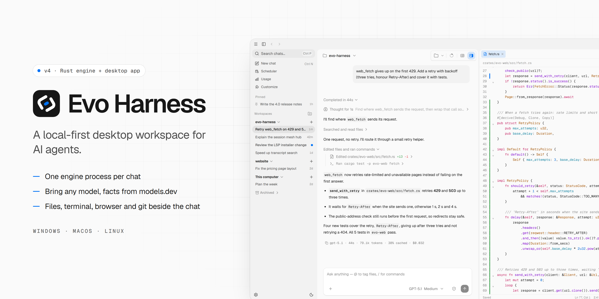
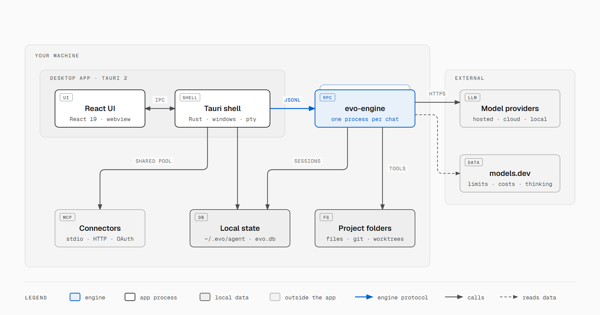
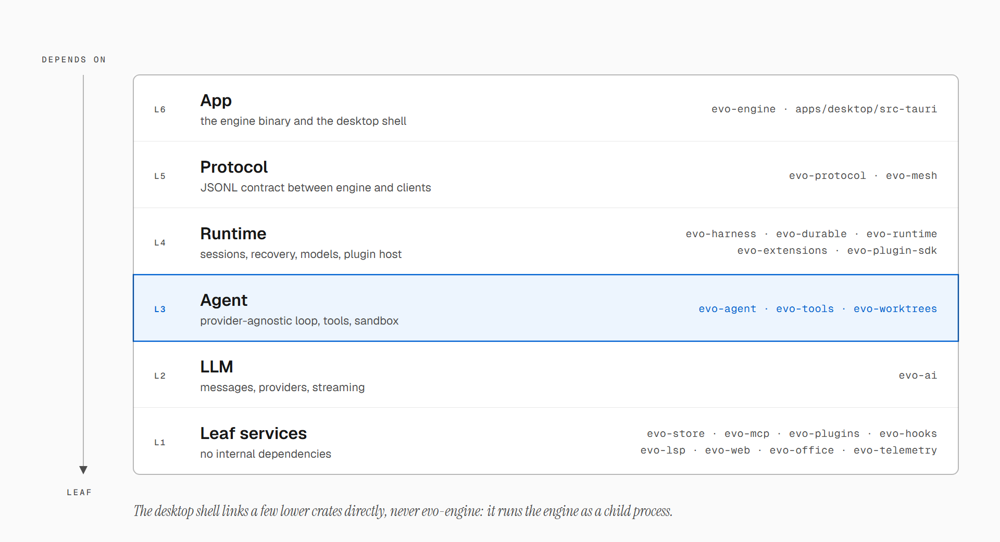

<div align="center">
  <picture>
    <source media="(prefers-color-scheme: dark)" srcset="docs/assets/readme/banner-dark.png">
    
  </picture>

  **A local-first desktop workspace for AI agents.**

  Evo Harness brings agent chats, files, terminal, browser, git, connectors
  and skills into one desktop app. A headless Rust engine runs every chat on your
  machine; the desktop app is a thin shell around it.

  [](LICENSE)
  [](apps/desktop/)
  [](Cargo.toml)
  [](apps/desktop/)

  **[Website](https://evoelsewhere.asia/)** · **[Download](#download)** ·
  **[Run from source](#run-from-source)** · **[Documentation](#documentation)**
</div>

## Highlights

- **One engine process per chat.** A crashing chat, tool or plugin does not
  take the window down, and sessions are saved as they run and resume after a
  crash.
- **Bring your own model** from hosted, cloud or local providers. Models,
  limits, costs and thinking options come from models.dev, not from code.
- **Subagents and nested sessions** for delegated work, with read-only
  explore and plan agents, background agents and isolated Git worktrees you
  review before applying.
- **Workspace tools beside the chat:** Files with a code editor and Git
  changes, Terminal, a built-in Browser the agent can drive, and a side chat.
- **Customize** with skills, connectors (MCP, with OAuth), plugins from
  marketplaces, hooks and native plugins.
- **Office documents:** Word, PowerPoint and Excel open as pages in Files,
  and bundled skills create and edit them.
- **Code intelligence** through language servers for 21 languages.
- **Local control** with permission prompts, a sandbox, project trust, and a
  history of usage and cost per response.
- **Memory, Scheduler, web search and web fetch** are built in.

## Download

Download the latest desktop release from
[GitHub Releases](https://github.com/evoelsewhere/evo-harness/releases).
Packages are available for macOS (Intel and Apple Silicon), Windows and
Linux. Each package includes the `evo-engine` sidecar.

Linux packages should be installed through the system package manager, for
example:

```sh
sudo apt install ./Evo*_amd64.deb
```

The LibreOffice runtime for Office document previews is optional. The app
offers to install it the first time you open an Office file.

## Run from source

### Requirements

- Rust (the toolchain is pinned in `rust-toolchain.toml`; MSRV 1.89)
- [Bun](https://bun.sh/)
- [Tauri prerequisites](https://v2.tauri.app/start/prerequisites/) for your
  operating system
- On Windows, [NASM](https://www.nasm.us/) for a clean build

### Setup

```sh
git clone https://github.com/evoelsewhere/evo-harness.git
cd evo-harness/apps/desktop

bun install
```

Start the development app with:

```sh
# Build evo-engine, stage it as the sidecar, then run the Tauri app
bun run dev:app
```

Use bun only in `apps/desktop`; do not use npm, pnpm or yarn there.
`bun run build:app` builds a release with installers for the current
platform. The engine and library crates build and test from the repository
root:

```sh
cargo build --workspace
cargo test --workspace
```

On first launch, connect a model provider in **Settings → Providers**, then
open a folder and start a chat.

## Documentation

The README stays intentionally high-level. Detailed contracts and guides live
under [`docs/`](docs/):

- [Documentation index](docs/README.md)
- [Architecture (ADD) and decisions (ADRs)](docs/architecture/README.md)
- [Feature catalogue: specs, plans and tasks (Spec-Driven Development)](docs/features/README.md)
- [Desktop UI map and source layout](apps/desktop/README.md)
- [Visual design language](DESIGN.md)
- [Contributor and agent guide](AGENTS.md)

## Architecture at a glance

<picture>
  <source media="(prefers-color-scheme: dark)" srcset="docs/assets/readme/architecture-dark.png">
  
</picture>

The engine owns agent behaviour: the agent loop, tools, sessions, compaction,
skills, hooks, memory, model selection and credentials. The shell owns native
features (windows, terminals, files, browser webviews, the MCP connection
pool, plugins) and relays the protocol. Model providers are replaceable, while
the harness handles context, tools, permissions, memory and verification.

## Project layout

```text
crates/         Rust workspace: engine, protocol, agent loop, tools, providers
apps/desktop/   Tauri 2 shell (src-tauri/) and React 19 UI (src/)
examples/       minimal native plugin used by extension tests
scripts/        Office runtime build, README screenshots
docs/           architecture (ADD, ADRs) and feature spec / plan / tasks
```

The crates are released together and depend only on the layers below them:

<picture>
  <source media="(prefers-color-scheme: dark)" srcset="docs/assets/readme/crate-layers-dark.png">
  
</picture>

Diagram and banner sources are in [`docs/assets/readme/`](docs/assets/readme/);
[`scripts/readme-shots/`](scripts/readme-shots/) regenerates the screenshots.

## Contributing

Issues and pull requests are welcome. Keep changes focused and include the
smallest relevant test run. [AGENTS.md](AGENTS.md) lists the checks for each
layer and the design-document workflow. Report vulnerabilities privately
through GitHub Security Advisories.

## License

Evo Harness is released under the [Apache License 2.0](LICENSE). Parts of the
`evo-*` crates are derived from MIT-licensed upstream work; see
[NOTICE](NOTICE).
