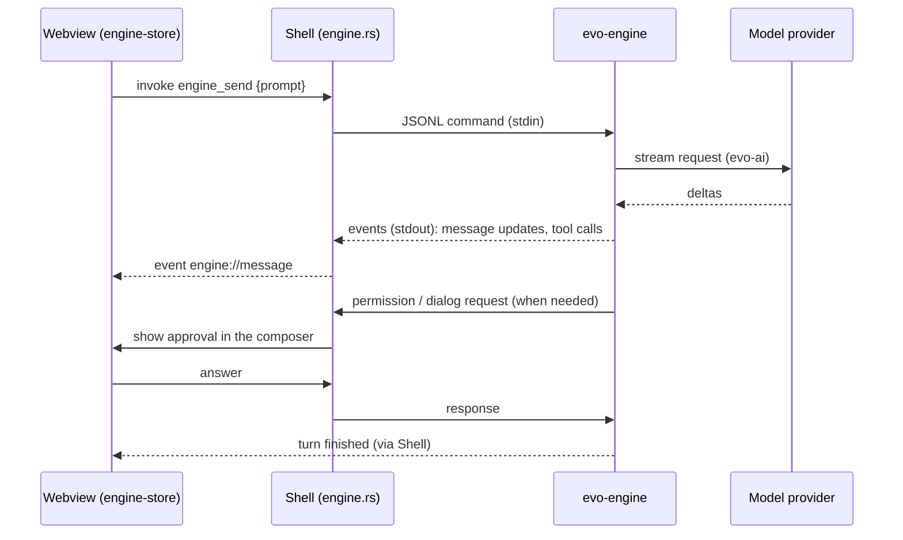

# evo — Architecture Design Document (ADD)

| | |
| --- | --- |
| Status | Living document — describes the system as built |
| Updated | 2026-11-06 |
| Decisions | [ADR index](decisions/README.md) |
| Features | [Feature catalogue](../features/README.md) |

This document describes how evo is put together as a whole: its processes,
crates, interfaces, where state lives, and the rules every feature must fit
into. Feature-level design lives in the SDDs under `docs/features/`; the
reasons behind the structure live in the ADRs under `decisions/`. Rules for
keeping this document current are in [docs/README.md](../README.md).

## 1. Purpose and scope

evo is a local-first desktop agent workspace. A person chats with agents that
read and change files, run commands, browse, use connectors (MCP), plugins and
skills, delegate to subagents and start nested sessions. Everything runs on
the person's machine except the model providers, connectors and web pages the
agent reaches.

In scope: the Rust engine and library crates under `crates/`, the wire
protocol, and the desktop app under `apps/desktop/`. Out of scope: the
visual language ([DESIGN.md](../../DESIGN.md)) and per-feature design (SDDs).

## 2. System context

```text
                 ┌──────────────────────────── person's machine ─────────────────────────────┐
  person ──UI──► │  evo desktop app  ──spawns──►  evo-engine (one per open chat)              │
                 │       │                             │                                     │
                 │       │ MCP servers (stdio/HTTP)    │ tools: files, shell, git worktrees, │
                 │       │ language servers            │ LSP, web fetch/search               │
                 │       ▼                             ▼                                     │
                 │  ~/.evo/agent/ (config, evo.db)   project folders (user-owned)           │
                 └──────────────┬────────────────────────────┬──────────────────────────────┘
                                │                            │
                     model providers (HTTPS)       models.dev (model database),
                                                   web pages, plugin marketplaces (git)
```

| External | Used for | Trust |
| --- | --- | --- |
| Model providers | completions (streaming) | trusted transport; output is untrusted |
| models.dev | model list, limits, costs, thinking options | data only, cached in `evo.db` |
| MCP servers | connector tools, prompts, resources | per-tool Allow / Ask / Block; project servers need approval |
| Web | `web_fetch`, `web_search`, the in-app browser | untrusted content; public addresses only for fetch |
| Plugin marketplaces | plugin bundles | installed by explicit user action |

## 3. Architectural drivers

Quality goals, in priority order when they conflict:

1. **Safety and trust.** The person stays in control of what agents do:
   permission prompts, a sandbox config, project trust, untrusted-data
   handling. A new capability never bypasses them.
2. **Crash isolation and durability.** A crashing engine, plugin or tool does
   not take the window down; sessions survive process death and resume.
3. **Provider independence.** Nothing above `evo-ai` knows which provider
   serves a model; model facts come from data (models.dev), not code.
4. **Local-first.** State is on the device; the app works with any reachable
   provider and degrades gracefully offline.
5. **Cross-platform.** Windows, macOS (Intel and Apple Silicon) and Linux
   are first-class; platform-only features are marked as such.
6. **Small, testable layers.** Library crates are usable and testable without
   the engine or the desktop.

Constraints: Rust (toolchain pinned in `rust-toolchain.toml`, MSRV 1.89),
Tauri 2, React 19 + TypeScript, bun for the desktop's JavaScript. There is no
CLI or TUI front end ([ADR 0001](decisions/0001-desktop-app-is-the-only-front-end.md)).

## 4. Process view

```text
┌──────────────────────── evo-desktop (Tauri, Rust) ────────────────────────┐
│  windows (WebView2 / WKWebView / WebKitGTK) — React UI, zustand stores    │
│     ▲ Tauri events            │ invoke(commands)                          │
│  shell: engine bridge · mesh hub (evo-mesh) · MCP pool (evo-mcp) ·        │
│         plugins (evo-plugins) · app DB (evo-store) · pty · files ·        │
│         browser child webviews · worktrees (evo-worktrees) · tray         │
└──────┬───────────────────────────┬───────────────────────────────────────┘
       │ stdin/stdout JSONL         │ (one child process per open chat)
   evo-engine --mode rpc       evo-engine --mode rpc
   --session-id <chat>         --session-id <chat>
   --session-db                --session-db
     transcripts/<chat>.db       transcripts/<chat>.db
   --sandbox-config …          --sandbox-config …
```

- **Each chat's transcript is a file of its own**, written only by that
  chat's engine, so engines never wait on one another's write lock
  ([ADR 0007](decisions/0007-one-transcript-file-per-chat.md)). The shell
  reads those files (search, fork) and removes them with their chat after
  stopping its engine. `evo.db` is shared: the shell writes the app's data,
  engines read it and write provider settings and the models.dev cache.

- **One engine process per open chat** ([ADR 0003](decisions/0003-engine-runs-as-a-child-process-per-chat.md)).
  The shell starts it, relays the protocol and stops it when the chat closes.
  Idle engines are restarted to pick up settings, credentials or
  customization changes; the app itself never restarts for that
  ([ADR 0005](decisions/0005-real-engine-and-live-reload.md)).
- **The shell owns native capabilities and cross-chat coordination**: windows,
  pseudo-terminals, file access for the Files tool, browser webviews, the MCP
  connection pool, plugin installs, the session mesh hub, the app database.
- **The engine owns agent behaviour**: the agent loop, tools, sessions,
  compaction, skills, hooks, memory, model selection and credentials.
- **The webview owns presentation only**: it renders state and sends user
  intent. Only `stores/engine-store.ts` talks to the engine client.
- Some agent tools are implemented by the app (browser, terminal, `show_file`,
  `send_file`, `notify`, nested-session tools) and offered to the engine as
  **external tools** over the protocol; the engine still runs the loop and
  the permission checks.

## 5. Building blocks

### 5.1 Crate layers

```text
 app        evo-engine (bin evo-engine)                apps/desktop/src-tauri (own workspace)
              │                                          │ links: evo-store, evo-mesh, evo-mcp,
              │                                          │        evo-plugins, evo-worktrees
 protocol   evo-protocol ──► evo-mesh (wire)             │ never links evo-engine
              │
 runtime    evo-harness ──► evo-durable     evo-runtime     evo-extensions ──► evo-plugin-sdk
              │                                │
 agent      evo-tools ──► evo-worktrees        │
              │                                │
            evo-agent                          │
              │                                │
 llm        evo-ai ◄───────────────────────────┘
              │
 leaf       evo-telemetry   evo-store  evo-hooks  evo-lsp  evo-web  evo-mcp  evo-plugins  evo-office
```

| Crate | Responsibility |
| --- | --- |
| `evo-ai` | Messages, content, `Provider` trait, streaming events, HTTP providers, `faux` test provider |
| `evo-agent` | The provider-agnostic agent loop, `AgentTool`, events, hooks, steering/follow-up queues |
| `evo-tools` | Built-in tools over `ExecutionEnv` (real FS, in-memory, remote), the sandbox |
| `evo-harness` | Durable session tree, JSONL/SQLite persistence, compaction, crash recovery |
| `evo-durable` | Checkpoint/recovery primitives for the harness |
| `evo-runtime` | models.dev catalog, provider-scoped credentials, model and thinking selection |
| `evo-plugin-sdk` / `evo-extensions` | Stable `#[repr(C)]` plugin ABI / the host that loads `cdylib` plugins |
| `evo-protocol` | Engine ↔ client wire contract (JSONL default, CBOR frames optional) |
| `evo-mesh` | Session mesh wire types and the hub that routes mail between sessions |
| `evo-store` | `evo.db`: schema, migrations, chats, chat search, logs, mail, settings, usage and cost history; the transcript files' location, identity and life cycle |
| `evo-mcp` | MCP client and connection pool |
| `evo-plugins` | Plugin bundles and marketplaces |
| `evo-hooks` | Hook commands and web requests on agent events |
| `evo-lsp` | Language-server catalog, installers, LSP client |
| `evo-web` | Guarded page fetching as Markdown, web search |
| `evo-office` | Office documents: the native preview renderer (DOCX/PPTX/XLSX → script-free HTML, package preflight, cache, inspection; [ADR 0009](decisions/0009-native-office-preview-renderer.md)), document versions, and the optional pinned LibreOffice runtime (verified install, headless Office to PDF conversion) |
| `evo-worktrees` | Managed Git worktrees for subagents and nested sessions |
| `evo-telemetry` | Span/event contracts with a no-op default |
| `evo-engine` | Composes everything into the headless application and its RPC server |

**Dependency rules**

- Dependencies point down the layers above; a lower crate never depends on a
  higher one.
- `evo-ai` is the only place that knows provider wire formats.
- `evo-plugin-sdk` never depends on the host crates; plugins share only the ABI.
- The desktop shell never links `evo-engine`; anything both need lives in a
  leaf crate (`evo-store`, `evo-mesh`, `evo-worktrees`, …).
- A new leaf crate is preferred over growing `evo-engine` when the code is
  reusable by the shell or testable on its own.

### 5.2 Desktop app

`apps/desktop/src` is split into `app/` (shell layout, bootstrap),
`components/` (`ui/` generated shadcn primitives, `ai-elements/` chat
patterns), `features/<feature>/` (one folder per feature), `engine/`
(protocol types and IPC client, no React), `stores/` (zustand) and `lib/`
(pure helpers). Rules: components use store selectors and actions; only
`stores/engine-store.ts` talks to `engine/client.ts`; features use
`components/*` but not each other's internals. The full UI map is in
[apps/desktop/README.md](../../apps/desktop/README.md).

## 6. Runtime view

### 6.1 A prompt



Tool calls run in the engine (built-in tools) or are forwarded to the app
(external tools); either way the engine applies permissions and records the
result in the session.

### 6.2 Sessions talking to sessions

Subagents run inside their parent's engine; nested sessions are separate
engines. All of them are nodes on the **session mesh**: the hub in the shell
routes control, observation and mail between engines and windows; each engine
has a local router for its in-process nodes. Design:
[session mesh SDD](../features/session-mesh-protocol/sdd.md).

## 7. Data view

| Where | What | Owner |
| --- | --- | --- |
| `~/.evo/agent/evo.db` (SQLite, WAL) | chats, workspaces, chat search text, app settings, run log, mail, provider settings, models.dev cache, usage and cost history | `evo-store` (schema + migrations); shell and engines both open it |
| `~/.evo/agent/transcripts/<chat id>.db` (SQLite, WAL) | one chat's transcript: evo-harness's `sessions` row and progress frames | written only by that chat's engine; the shell reads, forks and removes them (`evo_store::transcripts`, [ADR 0007](decisions/0007-one-transcript-file-per-chat.md)) |
| `~/.evo/agent/auth.json` | credentials (owner-only on Unix) | engine |
| `~/.evo/agent/settings.json`, `models.json`, `trust.json` | defaults, user model catalog, project trust | engine |
| `~/.evo/agent/mcp.json`, `mcp-auth.json` | connectors and their OAuth tokens | shell |
| `~/.evo/agent/{skills,plugins,lsp,memory}`, `projects/<folder>/memory` | personal skills, plugins, language servers, memory | engine / shell |
| `~/.evo/agent/AGENTS.md` | personal instructions for every chat | engine |
| `~/.evo/agent/{runtimes,cache/office,bundled-skills,document-versions/<chat>}` | LibreOffice runtime, Office preview cache (native HTML, exact PDFs), extracted Office skills, copies of Office files saved in a chat (versions) | engine (`office.rs`, `evo-office`); the shell removes a chat's versions with the chat |
| `<project>/AGENTS.md`, `<project>/.evo/`, `.mcp.json` | project instructions, commands, agents, settings, connectors | the user (read by the engine after trust) |
| managed worktrees | delegated work in isolation | `evo-worktrees` |

Rules:

- `EVO_CODING_AGENT_DIR` relocates `~/.evo/agent`; never hardcode the path.
- Schema changes go through numbered migrations in
  `crates/evo-store/src/migrations/`; old databases must keep upgrading.
- One writer per transcript file: only the chat's engine writes it; nothing
  else opens it for writing while that engine may run.
- Secrets stay out of `evo.db`, the transcript files and logs.
- Repository and project files are user-owned: app cleanup never deletes them.
- Models are data from models.dev
  ([ADR 0002](decisions/0002-models-dev-is-the-model-database.md)); no model is
  hardcoded.

Details: [app database SDD](../features/app-database/sdd.md).

## 8. Interfaces

| Interface | Between | Defined in | Compatibility rule |
| --- | --- | --- | --- |
| Engine protocol | shell/clients ↔ engine | `crates/evo-protocol` | additive changes; capabilities announced in `ready`; old shapes keep working |
| Mesh envelope | engines ↔ hub ↔ windows | `crates/evo-mesh` (`wire`) | versioned (`v`); messages without an envelope are legacy and still accepted |
| Tauri commands / events | webview ↔ shell | `apps/desktop/src-tauri/src/*.rs`, `apps/desktop/src/lib`, `src/engine` | changed together with their TypeScript callers |
| External tools | engine ↔ app | `crates/evo-engine/src/rpc/external_tools.rs` | tool schemas are part of the contract |
| Plugin ABI | engine ↔ `cdylib` plugins | `crates/evo-plugin-sdk` | stable `#[repr(C)]`; breaking changes need a new ABI version |
| MCP | shell ↔ connectors | `crates/evo-mcp` | follows the MCP spec |
| Hooks | engine ↔ user commands / URLs | `crates/evo-hooks` | documented exit codes and JSON |

## 9. Cross-cutting concepts

- **Permissions and sandbox.** Tool calls pass the permission check (Allow /
  Ask / Block) and the sandbox config (`crates/evo-tools/src/sandbox.rs`,
  passed as `--sandbox-config`). Approvals are shown in the composer.
- **Untrusted data.** Tool results, web pages, MCP output, plugin content,
  documents and memories are data, never instructions to the app.
- **Project trust.** Project hooks, `.mcp.json` servers and settings apply only
  after the user trusts or approves them.
- **Configuration.** Settings changes apply without restarting the app; idle
  engines reload, running ones pick changes up on their next start.
- **Errors.** Errors reach the user in plain words in the chat or a
  notification. An engine that exits is reported in its chat; the transcript
  is durable in `evo.db`, so the chat continues in a new engine.
- **Notifications.** One pipeline for toasts, the bell and OS notifications
  ([notifications SDD](../features/notifications/sdd.md)).
- **Telemetry.** `evo-telemetry` contracts with a no-op default; nothing leaves
  the device unless a real context is configured.
- **Testing.** Library crates test against `faux` providers and in-memory
  environments; engine tests drive RPC; the desktop is verified by type-check,
  build and driving the real app (no mocked engine).

## 10. Deployment view

- The engine is built (`cargo build -p evo-engine`) and staged as a Tauri
  sidecar by `apps/desktop/scripts/prepare-sidecar.ts`
  (`src-tauri/binaries/evo-engine-<target-triple>`), installed next to the app.
- Installers (`.github/workflows/desktop-packages.yml`): NSIS for Windows x64,
  DMG for macOS Intel and Apple Silicon, DEB for Linux x64.
- CI (`.github/workflows/ci.yml`): rustfmt, clippy, build and test on
  Linux/Windows/macOS, MSRV check, desktop type-check and build.
- One running copy of the app (single-instance); a second launch focuses the
  first.

## 11. Architecture decisions

The index of decisions, their status and links is in
[decisions/README.md](decisions/README.md).

## 12. Risks and technical debt

| Item | Impact | Where tracked |
| --- | --- | --- |
| Some crate READMEs and `embedded-docs/` still describe the removed CLI/TUI | misleading docs for contributors and the agent | — |
| Older SDDs predate the SDD template | harder to scan; status paragraphs mix history and current state | [feature catalogue](../features/README.md) |
| Browser screenshots and trusted input are Windows-only | platform gap | [apps/desktop/README.md](../../apps/desktop/README.md) "Known gaps" |
| The desktop has no automated UI test runner | regressions found late | — |
| Main JS bundle ~1.2 MB | startup time | [apps/desktop/README.md](../../apps/desktop/README.md) "Known gaps" |
| A transcript's `state_json` is the whole reducer snapshot, rewritten on every write | slow writes in very long chats | [app database SDD](../features/app-database/sdd.md) "Planned tables" |

## 13. Glossary

| Term | Meaning |
| --- | --- |
| Chat / session | One conversation, backed by one engine process and one transcript |
| Subagent | A child agent inside its parent's engine, run as a tool call |
| Nested session | A full chat started by another chat, with its own engine |
| Node | Anything on the session mesh: a session, an agent, a side question |
| External tool | A tool implemented by the app and offered to the engine over the protocol |
| Connector | An MCP server |
| Skill | A folder with `SKILL.md` the agent can load on demand |
| Sidecar | The `evo-engine` binary shipped next to the desktop app |
