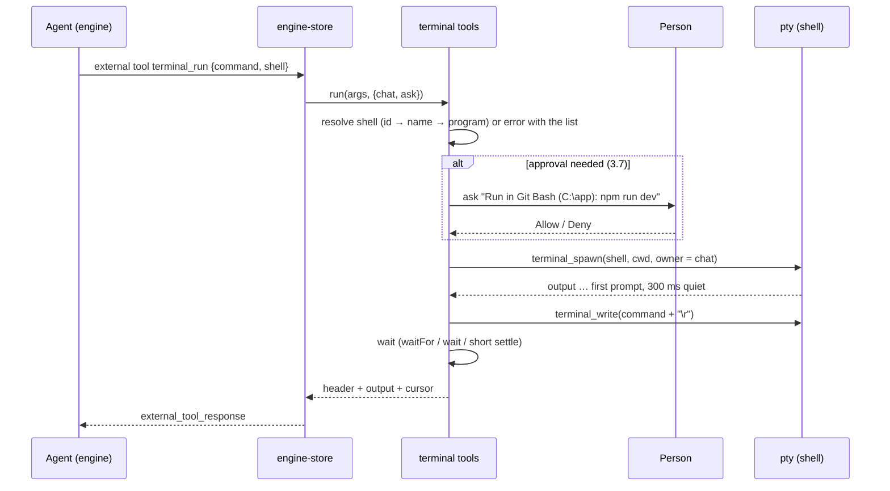

# Agent terminal: shell choice and interactive tools — Plan

| | |
| --- | --- |
| Spec | [spec.md](spec.md) |
| Tasks | [tasks.md](tasks.md) |
| Updated | 2026-11-07 |
| ADD sections | [5.2 Desktop app](../../architecture/README.md#52-desktop-app), [8. Interfaces](../../architecture/README.md#8-interfaces) (external tools), [9. Cross-cutting concepts](../../architecture/README.md#9-cross-cutting-concepts) (permissions and sandbox) |
| ADRs | none |

## 1. Context and constraints

- **Today's tools.** `terminal_run` and `terminal_read` live in
  `apps/desktop/src/features/browser/agent-tools.ts` (`terminalTool`). `terminal_run`
  always creates a tab with the default shell, waits 800 ms, types one line,
  waits 1.5 s and returns the screen. `terminal_read` lists tabs or returns the
  last lines of a tab's xterm buffer after an optional fixed wait.
- **Tool routing.** The app registers `UI_TOOLS` as external tools and runs them
  in `apps/desktop/src/stores/engine-store.ts` (`runUiTool`, around line 955)
  **without any approval**, unlike scheduler and connector tools, which go
  through `askApproval` (`ui_dialog_request`, answered in the composer's
  approval panel).
- **Approval mode is not enforced.** The composer's approval picker
  (`ApprovalMode` = `ask` · `auto-edits` · `auto` in `stores/ui-store.ts`, menu in
  `features/chat/chat-composer.tsx`) is stored but read nowhere else and never
  sent to the engine. The engine asks only through plugin tool-call handlers,
  `PreToolUse` hooks and the self-kill guard
  (`crates/evo-engine/src/session.rs`, `before_tool_call` chain). So "Ask every
  time" does not currently stop the engine's own shell tools either; that is
  fixed separately ([approval modes](../approval-modes/spec.md), spec 2.2).
- **Terminal plumbing.** `apps/desktop/src-tauri/src/terminal.rs` runs one pty
  per tab (ConPTY on Windows): `terminal_shells`, `terminal_spawn(shell, cwd,
  cols, rows)`, `terminal_write`, `terminal_resize`, `terminal_kill`,
  `terminal_list`, `terminal_attach` (512 KB backlog for reloads). Sessions
  belong to the window that started them. The UI side is
  `apps/desktop/src/stores/terminal-store.ts` (tabs, default shell) and
  `apps/desktop/src/features/terminal/terminal-instance.ts` (xterm.js, 10,000
  lines of scrollback, `send`).
- **Shell discovery today.** Windows: `pwsh` on `PATH`, Windows PowerShell,
  `ComSpec`, Git Bash next to `git.exe` or in the usual folders, `wsl.exe`
  (default distribution only). Unix: `$SHELL` with id `default`, then fixed
  paths for zsh, bash, fish and sh, then `nu` and `pwsh` on `PATH`. A macOS GUI
  app's `PATH` is `/usr/bin:/bin:/usr/sbin:/sbin`, so Homebrew shells in
  `/opt/homebrew/bin` and `/usr/local/bin` are missed, and the `default` id
  differs between machines.
- **Rules.** Features use other features only through their public entry
  (`features/terminal/index.ts`); only `engine-store.ts` talks to the engine
  client; terminal output is untrusted data (ADD §9).

## 2. Architecture check

| Rule | Result | Notes |
| --- | --- | --- |
| The engine owns agent logic; the shell relays and provides native features | ok | The engine decides when to call the tools; the app runs them as external tools, as it already does for scheduler and connector tools. The pty stays a native feature of the shell. The engine does not know about tabs or owners, so the gate lives in the app (section 4). |
| Layers point down; library crates stay free of engine/desktop concerns | n/a | No library crate changes. |
| Protocol changes update `evo-protocol`, the engine and the desktop together | n/a | Uses the existing external-tool and `ui_dialog_request` flow; no protocol change. The Tauri commands change together with `features/terminal/pty.ts`. |
| Models come from models.dev; no hardcoded model facts | n/a | No model data. |
| Real engine in the app; settings and credentials reload live | ok | Runs against the real engine; the default shell and the shell-integration setting apply to the next new tab without a restart. |
| Untrusted input stays untrusted; permissions, sandbox and project trust stay in the path | ok | Terminal output is data (3.7); every run, send and foreign-tab action goes through the approval panel; agent tabs follow the sandbox's `inheritEnv` rule. |
| Desktop UI structure and `DESIGN.md` | ok | The terminal tools move from `features/browser` to `features/terminal` and are reached through `features/terminal/index.ts`; only `engine-store.ts` talks to the engine client. |
| Architecture changes have an ADD edit and an ADR | ok | No ADR: the feature applies the existing approval flow to app-side tools. ADD §9 gains one sentence (tasks T13). |

## 3. Design

### 3.1 Overview

```text
 agent ──external tool call──▶ engine-store.ts ──▶ terminal tools (features/terminal/agent-tools.ts)
                                   │  askApproval (mode + ownership)        │
                                   ▼                                        ▼
                             approval panel                     terminal-store.ts ── owner, output log, waiters
                                                                            │
                                                         terminal-instance.ts (xterm, OSC 133 for FR-16)
                                                                            │  terminal_write / spawn / kill
                                                                            ▼
                                                         src-tauri terminal.rs ── pty per tab, shell discovery
```

The terminal tools move out of the browser feature into the terminal feature.
Every call first resolves the tab and its owner, then asks for approval when
the rules in 3.7 say so, then acts on the store. Each tab keeps a plain-text
output log with a running character offset; cursors, pattern waits and idle
waits all read that log. Shell integration (FR-16) adds command markers to the
same log.

### 3.2 Components

| Layer | Path | Responsibility | Requirements |
| --- | --- | --- | --- |
| desktop shell | `apps/desktop/src-tauri/src/terminal.rs` | Shell discovery; `ShellInfo` gains `kind` and `isDefault`; `terminal_spawn` takes `owner` (kept in `SessionInfo` for reloads) and, for shell integration, extra args and env; killing a session ends its process tree. | FR-1, FR-2, FR-3, FR-10, FR-11, FR-16, NFR-1, NFR-2 |
| desktop shell | `apps/desktop/src-tauri/src/shell_integration/` | Integration scripts for PowerShell, bash, zsh and fish, written to the app's data folder on start. | FR-16 |
| desktop UI | `apps/desktop/src/features/terminal/agent-tools.ts` (new) | Tool schemas and handlers: `terminal_list`, `terminal_run`, `terminal_send`, `terminal_read`, `terminal_kill`; shell name resolution; key names to bytes; password-prompt check. | FR-4–FR-10, FR-14, NFR-4 |
| desktop UI | `apps/desktop/src/features/terminal/output-log.ts` (new) | Per-tab escape-free output log (1 MB ring, running offset), waiters for regex / idle / exit, command markers for FR-16. | FR-6, FR-8, FR-9, FR-16, NFR-3, NFR-4, NFR-5 |
| desktop UI | `apps/desktop/src/features/terminal/terminal-instance.ts` | Feeds data to the output log; registers the OSC 133 handler (FR-16). | FR-8, FR-16 |
| desktop UI | `apps/desktop/src/stores/terminal-store.ts` | `TerminalTab.owner`; `create({ shell, cwd, owner })`; `kill(key)`. | FR-5, FR-10, FR-11 |
| desktop UI | `apps/desktop/src/features/terminal/terminal-panel.tsx` | Marks tabs an agent started (a small agent icon and the chat title in the tooltip). | FR-11 |
| desktop UI | `apps/desktop/src/features/browser/agent-tools.ts` | Drops `terminalTool`; `UI_TOOLS` includes the terminal tools from `features/terminal`. | FR-4, FR-5 |
| desktop UI | `apps/desktop/src/stores/engine-store.ts` | Passes the chat id and an `ask` callback to terminal tools (as for scheduler tools); keeps the per-chat read permission; ends waits when the engine drops the call. | FR-9, FR-12, FR-13, NFR-5 |
| desktop UI | `apps/desktop/src/components/ai-elements/tool.tsx` | Rendering of the five tools. | FR-15 |

### 3.3 Interfaces

**Agent tools** (external tools; schemas are part of the contract, ADD §8).
`terminal_read` and `terminal_run` keep their names and accept their old
arguments, so old transcripts render and old habits still work.

```jsonc
// terminal_list — shells and tabs, no tab content
{ "type": "object", "properties": {}, "additionalProperties": false }

// terminal_run — start a command in a new tab or an existing one
{
  "type": "object",
  "properties": {
    "command":   { "type": "string", "description": "One line, typed into the shell and run." },
    "shell":     { "type": "string", "description": "Shell id, name or program from terminal_list (e.g. pwsh, git-bash, zsh, wsl:Ubuntu). Default: the person's default shell." },
    "tabId":     { "type": "string", "description": "Run in this existing tab instead of a new one." },
    "cwd":       { "type": "string", "description": "Folder for a new tab; default the working folder." },
    "waitFor":   { "type": "string", "description": "Regular expression to wait for in the new output." },
    "wait":      { "type": "boolean", "description": "Phase 2: wait until the command finishes and return its exit code." },
    "timeoutMs": { "type": "number", "description": "Longest wait, default 15000, max 120000." }
  },
  "required": ["command"],
  "additionalProperties": false
}

// terminal_send — type text and/or press keys
{
  "type": "object",
  "properties": {
    "tabId": { "type": "string" },
    "text":  { "type": "string", "description": "Typed as is; a newline presses Enter." },
    "keys":  { "type": "array", "items": { "type": "string" }, "description": "Pressed after the text, in order: enter, tab, esc, backspace, up, down, left, right, home, end, pageup, pagedown, ctrl+a … ctrl+z." }
  },
  "required": ["tabId"],
  "additionalProperties": false
}

// terminal_read — new output since a cursor, or the screen
{
  "type": "object",
  "properties": {
    "tabId":       { "type": "string", "description": "Without it, the result is terminal_list's (kept for older prompts)." },
    "since":       { "type": "number", "description": "Cursor from an earlier result: return only output after it." },
    "lines":       { "type": "number", "description": "Without since: last lines of the screen, default 80, max 1000." },
    "waitFor":     { "type": "string", "description": "Regular expression to wait for in new output." },
    "untilIdleMs": { "type": "number", "description": "Wait until no output arrives for this long." },
    "timeoutMs":   { "type": "number", "description": "Longest wait, default 15000, max 120000." },
    "waitMs":      { "type": "number", "description": "Deprecated: a fixed wait, kept for compatibility." }
  },
  "additionalProperties": false
}

// terminal_kill — stop a tab's shell (and what it started)
{
  "type": "object",
  "properties": {
    "tabId": { "type": "string" },
    "close": { "type": "boolean", "description": "Also close the tab." }
  },
  "required": ["tabId"],
  "additionalProperties": false
}
```

Results are text with a short header line the transcript also parses:

```text
Tab t3 · Git Bash · C:\work\app · running · started by this chat · cursor 18342
matched "ready on" after 4.2 s
<output>
```

**Key names → bytes** (sent with `terminal_write`): `enter` `\r`, `tab` `\t`,
`esc` `\x1b`, `backspace` `\x7f`, `up/down/right/left` `\x1b[A/B/C/D`,
`home` `\x1b[H`, `end` `\x1b[F`, `pageup` `\x1b[5~`, `pagedown` `\x1b[6~`,
`ctrl+<letter>` byte 1–26. ConPTY turns `\x03` into Ctrl+C for console
programs.

**Tauri commands** (changed together with `features/terminal/pty.ts`):

```rust
#[derive(Serialize)] #[serde(rename_all = "camelCase")]
pub struct ShellInfo { id: String, name: String, program: String, kind: ShellKind, is_default: bool }
pub enum ShellKind { Powershell, Cmd, Posix, Fish, Nu, Wsl }

#[tauri::command]
pub async fn terminal_spawn(…, shell: Option<String>, cwd: Option<String>, cols: u16, rows: u16,
                            owner: Option<String> /* chat id */) -> Result<SessionInfo, String>;
// SessionInfo gains `owner: Option<String>`; terminal_list returns it, so a reload keeps it.
```

### 3.4 Data and storage

- Tab owner: in the shell's session (`SessionInfo.owner`) for the life of the
  pty, mirrored in `TerminalTab.owner`. Not written to `evo.db`.
- Output log: in memory per tab in the webview, 1 MB ring of escape-free text
  with a running offset; dropped when the tab closes. A window reload rebuilds
  it from the shell's 512 KB backlog, so cursors from before a reload restart
  at the backlog's start (the result says so).
- Per-chat read permission for a person's tab: in memory in `engine-store.ts`,
  dropped when the app restarts.
- Shell-integration scripts (FR-16): `<app data>/shell-integration/evo.{ps1,bash,zsh,fish}`,
  rewritten on each start.

### 3.5 Behaviour

**Run in a new tab.**



**Run in an existing tab.** Same, minus the spawn. Without shell integration
the tool cannot know the tab is at a prompt; it types anyway and returns the
new output, so the agent sees if a program was still running.

**Read.** Without `since`: the screen (last `lines`). With `since`: the log
after the cursor. With `waitFor` / `untilIdleMs`: register a waiter on the log
first, then return on match, quiet, exit, timeout or cancellation, whichever
comes first.

**Send.** Check the tab's last line against the password-prompt pattern
(`/(password|passphrase|pin)[^:]*:\s*$/i`, plus `[sudo]`) when `text` is set;
write the text (newlines as `\r`), then each key; settle 300 ms and return the
new output.

**Kill.** `terminal_kill` ends the pty's process tree (Windows: the ConPTY
child and its job; Unix: the process group); `close` removes the tab.

**Shell integration (FR-16).** New tabs start with the integration script
for their shell:

| Shell | How it is loaded | Markers |
| --- | --- | --- |
| PowerShell 7 / 5.1 | `-NoExit -Command ". '<script>.ps1'"`, wraps `prompt` and `PSConsoleHostReadLine` | A, B, C, D;exit |
| bash, Git Bash, MSYS2, Cygwin | `--init-file <script>.bash`, which sources the person's own startup files first | `PROMPT_COMMAND` + `DEBUG` trap |
| zsh | `ZDOTDIR` to a folder whose `.zshrc` sources the person's, then adds `precmd` / `preexec` | A, B, C, D;exit |
| fish | `--init-command "source <script>.fish"` | `fish_prompt` / `fish_preexec` / `fish_postexec` |
| Command Prompt | `PROMPT` variable with the A/B sequences | A, B, D (no exit code) |
| WSL, Nushell | later work, [tasks.md](tasks.md) phase 3 (WSL needs the script path translated into the distribution) | — |

`terminal-instance.ts` registers an OSC 133 handler; each marker is stored in
the output log at the current offset. `wait: true` waits for the D marker that
follows the typed command and returns the text between C and D and the exit
code. A tab without markers falls back to `waitFor` / idle waits and says so.

### 3.6 Errors and edge cases

| Case | What the agent sees | What the person sees |
| --- | --- | --- |
| Unknown shell | Error with the available shell ids | Nothing |
| Shell fails to start | Error with the start failure | The tab's error view |
| Approval denied | "The person declined: <command>" | The approval closes |
| Tab gone or exited | Error, or the exit code in the header | — |
| Wait times out | Output so far, `timed out after N s` | — |
| Turn stopped during a wait or approval | The call ends (no result needed); the approval panel closes | The approval closes |
| Window reloaded | Tabs re-attach with owner; old cursors restart at the backlog start with a note | Tabs come back |
| Chat deleted | Its tabs keep running, owner shown as "a deleted chat"; another chat must ask to use them | Tab mark stays |
| Password prompt | `terminal_send` text refused: ask the person to type it | Nothing typed |
| Huge output | Last 20,000 characters and a note; cursor still advances | Full output in the tab |
| Two chats on one tab | The one that did not start it must ask (FR-13) | Approval per chat |
| WSL not installed or a distribution stopped | WSL shells missing from the list; a stopped distribution starts slowly but FR-6 waits for its prompt | — |

### 3.7 Security and trust

- **Approvals.** Rules per call, using the composer's approval mode (global,
  as today) and the tab's owner:

  | Call | Tab started by this chat | Tab of the person or another chat |
  | --- | --- | --- |
  | `terminal_list` | no prompt (no content returned) | no prompt |
  | `terminal_run` (new tab) | `ask`, `auto-edits`: ask · `auto`: run | — |
  | `terminal_run` (`tabId`), `terminal_send` | same as above | always ask |
  | `terminal_read` | no prompt | ask once per tab per chat |
  | `terminal_kill` | no prompt | always ask |

  The prompt names the shell, the folder and the exact command or keys.
- **Untrusted output.** Terminal output is data, never instructions; the tool
  description says so, as for web pages.
- **Secrets.** A person's tab may show tokens; that is why reading it asks.
  The agent never types after a password prompt (FR-14).
- **Sandbox.** Tabs the agent starts follow the sandbox's environment rule
  (`inheritEnv` off → the same reduced environment the shell tools get); the
  execution time limit does not apply, since these tabs are long-lived on
  purpose. Denied file patterns do not apply to a shell, the same as for the
  shell tools; the approval is the guard.
- **Integration scripts** are the app's own files, rewritten on every start;
  they source the person's startup files and add only prompt hooks.

### 3.8 Configuration

| Key | Type | Default | Where | Applies |
| --- | --- | --- | --- | --- |
| Default shell (existing) | shell id | first found (Windows) / `$SHELL` (Unix) | terminal store (local storage) | next new tab |
| `terminalShellIntegration` (FR-16) | boolean | `true` | app settings, **Settings → General → Terminal** | next new tab |

The approval mode stays in the composer. No new setting for the ownership
rules: they are fixed.

## 4. Alternatives considered

| Option | Why not |
| --- | --- |
| Use the engine's background shell commands instead of the visible terminal | Not interactive, and the person cannot watch or type into it; that remains the right tool for one-off commands. |
| Read raw bytes from the shell's backlog only | Full of escape codes and cursor moves; useless for full-screen programs. The escape-free log plus the xterm screen covers both streams and screens. |
| Keep the fixed 800 ms / 1.5 s sleeps | Too short for WSL and slow profiles, too long otherwise. |
| A tmux-style multiplexer | Not on Windows; the app already owns the ptys. |
| Import Windows Terminal profiles as the only shell list | Covers custom profiles and SSH, but it is absent on many machines and its location varies by install; it is added later as an extra source (tasks phase 3). |
| Gate terminal tools in the engine | The engine does not know about tabs or owners; the app does. The engine-wide approval gate is a separate fix. |

## 5. As-built notes

Empty until `In progress`.
