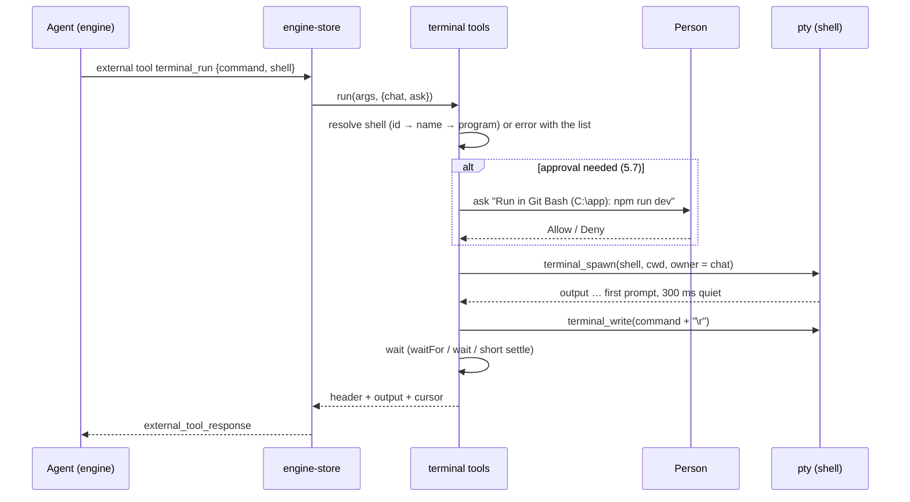

# Agent terminal: shell choice and interactive tools

| | |
| --- | --- |
| Status | Accepted |
| Area | desktop UI, desktop shell |
| Created | 2026-11-07 |
| Updated | 2026-11-07 |
| ADD sections | [5.2 Desktop app](../../architecture/README.md#52-desktop-app), [8. Interfaces](../../architecture/README.md#8-interfaces) (external tools), [9. Cross-cutting concepts](../../architecture/README.md#9-cross-cutting-concepts) (permissions and sandbox) |
| ADRs | none |
| Related | [Agent tools for working with the person](../agent-tools/sdd.md), [Approval modes enforced in the engine](../approval-modes/sdd.md) |

## 1. Summary

The agent can already start a command in the app's terminal (`terminal_run`)
and look at a tab's screen (`terminal_read`). It cannot pick the shell, type
into a tab that is already running, press keys such as Ctrl+C, stop a tab,
wait for a line such as "ready on :3000", or tell when a command finished and
with which exit code. These tools also skip the approval mode and read the
person's own tabs without asking. This feature lets the agent choose among the
shells found on the computer, work with a tab interactively, and do it under
the same approvals as its other commands.

## 2. Scope

### 2.1 Goals

- Find the shells people actually use on Windows, macOS and Linux, with ids
  that are the same on every machine.
- Let the agent list shells and tabs, start a command in a chosen shell or an
  existing tab, send text and keys, read only new output, wait for a pattern
  or for output to settle, and stop a tab.
- Know which chat started each tab, and ask before the agent runs commands,
  types into or reads a tab it did not start.
- Phase 2: know where each command starts and ends, and its exit code, through
  shell integration (OSC 133).

### 2.2 Non-goals

- One-off commands: the engine's own shell tools (`bash`, `powershell`) stay
  the way to run a command and get its output; the terminal is for long-lived
  and interactive work the person can watch.
- Engine-wide enforcement of the composer's approval mode for built-in tools:
  [approval modes](../approval-modes/sdd.md). This SDD gates only the
  terminal tools, in the app.
- Typing passwords or secrets for the person.
- Full-screen programs (vim, htop) beyond reading their current screen.
- Remote shells (SSH profiles). Windows Terminal profile import is phase 3.

## 3. Requirements

### 3.1 Functional

| ID | Requirement | Acceptance check |
| --- | --- | --- |
| FR-1 | On Windows the shell list holds every one of these that is installed: PowerShell 7, Windows PowerShell, Command Prompt, Git Bash, each WSL distribution, MSYS2 bash, Cygwin bash, Nushell. | Given a machine with Git, two WSL distributions and Nushell, when the terminal's "New terminal" menu opens, then it lists Git Bash, both distributions by name and Nushell. |
| FR-2 | On macOS and Linux the list holds the shells in `/etc/shells`, Homebrew's `bin` folders and the login shell's `PATH`; the login shell (`$SHELL`) is marked default. | Given macOS with Homebrew bash and fish, when the list loads, then it shows zsh (default), bash 5 from Homebrew and fish, once each. |
| FR-3 | Shell ids are stable across machines: the program's file name (`zsh`, `bash`, `pwsh`), plus `git-bash`, `msys2`, `cygwin`, `cmd`, `powershell`, `wsl:<distribution>`. | The same zsh is `zsh` whether or not it is `$SHELL`. |
| FR-4 | `terminal_list` returns the shells (id, name, default) and the tabs (id, title, shell, folder, status, who started it). It returns no tab content. | Called with one tab of the person's and one of this chat's, it lists both with owners `you` and `this chat`. |
| FR-5 | `terminal_run` starts a command in a new tab with a chosen shell (by id, name or file name), or in an existing tab (`tabId`). An unknown shell is an error that lists the available ids. | `{"command":"ls","shell":"Git Bash"}` opens a Git Bash tab; `{"shell":"tcsh"}` on Windows returns an error naming the shells found. |
| FR-6 | `terminal_run` types the command once the shell has printed its first prompt (output then 300 ms of quiet, at most 10 s), not after fixed sleeps. | A slow-starting WSL tab still receives the whole command. |
| FR-7 | `terminal_send` sends text and named keys (Enter, Tab, Esc, Backspace, arrows, Home, End, PageUp/PageDown, Ctrl+A–Z) to a tab. | Sending `["ctrl+c"]` to a tab running a dev server stops it and the tab shows a prompt again. |
| FR-8 | `terminal_read` with `since` returns only the output written after that cursor, without escape codes, and a new cursor; without `since` it returns the current screen. | Two reads in a row with the returned cursor return the new lines only. |
| FR-9 | `terminal_read` (and `terminal_run`) can wait for a regular expression in new output or for `untilIdleMs` of quiet, up to `timeoutMs` (max 120 s), and say whether it matched or timed out. Stopping the run ends the wait. | `waitFor: "ready on"` returns as soon as the line appears; a stopped turn returns at once. |
| FR-10 | `terminal_kill` stops a tab's shell and the programs it started; with `close: true` it also closes the tab. | After `terminal_kill`, the tab shows exited and the dev server's port is free. |
| FR-11 | Each tab records the chat that started it; the tab strip marks agent tabs, and the owner survives a window reload. | After a reload, `terminal_list` still shows the tab as `this chat`. |
| FR-12 | Commands follow the approval mode: `terminal_run` and `terminal_send` ask in "Ask every time" and "Approve edits", run directly in "Approve for me". | In "Ask every time", `terminal_run` shows an approval with the shell, folder and command, and nothing is typed until it is allowed. |
| FR-13 | Acting on a tab the chat did not start always asks: reading it (once per tab per chat), typing into it, running in it and stopping it, whatever the approval mode. | In "Approve for me", `terminal_read` on the person's tab asks "Let the agent read <tab>?" the first time only. |
| FR-14 | `terminal_send` refuses text when the tab's last line looks like a password prompt, and tells the agent to ask the person. | With `sudo` waiting for a password, sending text returns an error and types nothing. |
| FR-15 | The transcript shows each terminal call: the tool, shell and tab, the command or keys, and the output excerpt. | A `terminal_send` of Ctrl+C shows "Pressed Ctrl+C in <tab>". |
| FR-16 | Phase 2: in PowerShell, bash (incl. Git Bash and MSYS2), zsh and fish, `terminal_run` with `wait: true` returns when the command finishes, with its exit code and only its output. Command Prompt reports the end without an exit code. | `{"command":"git status","shell":"bash","wait":true}` returns `exit code 0` and the status text only. |

### 3.2 Non-functional

| ID | Requirement | Acceptance check |
| --- | --- | --- |
| NFR-1 | Platforms: Windows 10/11 (ConPTY), macOS 11+, Linux. | Manual check on Windows and macOS. |
| NFR-2 | Shell discovery takes under 300 ms on the UI's critical path; WSL distributions load in the background with a 3 s limit. | Opening the menu right after start does not wait for WSL. |
| NFR-3 | Each tab keeps at most 1 MB of plain output for cursors; a cursor older than that says how much was dropped. | Reading with a stale cursor returns a "… N characters dropped" line, then the kept output. |
| NFR-4 | A tool result holds at most 20,000 characters (the end of the output) and says when it was cut. | Reading a build log of 1 MB returns its last 20,000 characters and a note. |
| NFR-5 | Waiting does not block the UI or other chats' tools. | Two chats waiting on two tabs both return on time. |

## 4. Context and constraints

- **Today's tools.** `terminal_run` and `terminal_read` live in
  `apps/desktop/src/features/browser/agent-tools.ts` (`terminalTool`). `terminal_run`
  always creates a tab with the default shell, waits 800 ms, types one line,
  waits 1.5 s and returns the screen. `terminal_read` lists tabs or returns the
  last lines of a tab's xterm buffer after an optional fixed wait.
- **Tool routing.** The app registers `UI_TOOLS` as external tools and runs them
  in `apps/desktop/src/stores/engine-store.ts` (`runUiTool`, around line 955)
  **without any approval**, unlike scheduler and connector tools, which go
  through `askApproval` (`ui_dialog_request`, answered in the composer's
  approval panel).
- **Approval mode is not enforced.** The composer's approval picker
  (`ApprovalMode` = `ask` · `auto-edits` · `auto` in `stores/ui-store.ts`, menu in
  `features/chat/chat-composer.tsx`) is stored but read nowhere else and never
  sent to the engine. The engine asks only through plugin tool-call handlers,
  `PreToolUse` hooks and the self-kill guard
  (`crates/evo-engine/src/session.rs`, `before_tool_call` chain). So "Ask every
  time" does not currently stop the engine's own shell tools either; that is
  fixed separately (2.2).
- **Terminal plumbing.** `apps/desktop/src-tauri/src/terminal.rs` runs one pty
  per tab (ConPTY on Windows): `terminal_shells`, `terminal_spawn(shell, cwd,
  cols, rows)`, `terminal_write`, `terminal_resize`, `terminal_kill`,
  `terminal_list`, `terminal_attach` (512 KB backlog for reloads). Sessions
  belong to the window that started them. The UI side is
  `apps/desktop/src/stores/terminal-store.ts` (tabs, default shell) and
  `apps/desktop/src/features/terminal/terminal-instance.ts` (xterm.js, 10,000
  lines of scrollback, `send`).
- **Shell discovery today.** Windows: `pwsh` on `PATH`, Windows PowerShell,
  `ComSpec`, Git Bash next to `git.exe` or in the usual folders, `wsl.exe`
  (default distribution only). Unix: `$SHELL` with id `default`, then fixed
  paths for zsh, bash, fish and sh, then `nu` and `pwsh` on `PATH`. A macOS GUI
  app's `PATH` is `/usr/bin:/bin:/usr/sbin:/sbin`, so Homebrew shells in
  `/opt/homebrew/bin` and `/usr/local/bin` are missed, and the `default` id
  differs between machines.
- **Rules.** Features use other features only through their public entry
  (`features/terminal/index.ts`); only `engine-store.ts` talks to the engine
  client; terminal output is untrusted data (ADD §9).

## 5. Design

### 5.1 Overview

```text
 agent ──external tool call──▶ engine-store.ts ──▶ terminal tools (features/terminal/agent-tools.ts)
                                   │  askApproval (mode + ownership)        │
                                   ▼                                        ▼
                             approval panel                     terminal-store.ts ── owner, output log, waiters
                                                                            │
                                                         terminal-instance.ts (xterm, OSC 133 in phase 2)
                                                                            │  terminal_write / spawn / kill
                                                                            ▼
                                                         src-tauri terminal.rs ── pty per tab, shell discovery
```

The terminal tools move out of the browser feature into the terminal feature.
Every call first resolves the tab and its owner, then asks for approval when
the rules in 5.7 say so, then acts on the store. Each tab keeps a plain-text
output log with a running character offset; cursors, pattern waits and idle
waits all read that log. Phase 2 adds command markers from shell integration
to the same log.

### 5.2 Components

| Layer | Path | Responsibility |
| --- | --- | --- |
| desktop shell | `apps/desktop/src-tauri/src/terminal.rs` | Shell discovery (FR-1–3); `ShellInfo` gains `kind` and `isDefault`; `terminal_spawn` takes `owner` (kept in `SessionInfo` for reloads) and, in phase 2, extra args and env for shell integration; killing a session ends its process tree. |
| desktop shell | `apps/desktop/src-tauri/src/shell_integration/` (phase 2) | Integration scripts for PowerShell, bash, zsh and fish, written to the app's data folder on start. |
| desktop UI | `apps/desktop/src/features/terminal/agent-tools.ts` (new) | Tool schemas and handlers: `terminal_list`, `terminal_run`, `terminal_send`, `terminal_read`, `terminal_kill`; shell name resolution; key names to bytes; password-prompt check. |
| desktop UI | `apps/desktop/src/features/terminal/output-log.ts` (new) | Per-tab escape-free output log (1 MB ring, running offset), waiters for regex / idle / exit, phase 2 command markers. |
| desktop UI | `apps/desktop/src/features/terminal/terminal-instance.ts` | Feeds data to the output log; phase 2 registers the OSC 133 handler. |
| desktop UI | `apps/desktop/src/stores/terminal-store.ts` | `TerminalTab.owner`; `create({ shell, cwd, owner })`; `kill(key)`. |
| desktop UI | `apps/desktop/src/features/terminal/terminal-panel.tsx` | Marks tabs an agent started (a small agent icon and the chat title in the tooltip). |
| desktop UI | `apps/desktop/src/features/browser/agent-tools.ts` | Drops `terminalTool`; `UI_TOOLS` includes the terminal tools from `features/terminal`. |
| desktop UI | `apps/desktop/src/stores/engine-store.ts` | Passes the chat id and an `ask` callback to terminal tools (as for scheduler tools); ends waits when the engine drops the call. |
| desktop UI | `apps/desktop/src/components/ai-elements/tool.tsx` | Rendering of the five tools (FR-15). |

### 5.3 Interfaces

**Agent tools** (external tools; schemas are part of the contract, ADD §8).
`terminal_read` and `terminal_run` keep their names and accept their old
arguments, so old transcripts render and old habits still work.

```jsonc
// terminal_list — shells and tabs, no tab content
{ "type": "object", "properties": {}, "additionalProperties": false }

// terminal_run — start a command in a new tab or an existing one
{
  "type": "object",
  "properties": {
    "command":   { "type": "string", "description": "One line, typed into the shell and run." },
    "shell":     { "type": "string", "description": "Shell id, name or program from terminal_list (e.g. pwsh, git-bash, zsh, wsl:Ubuntu). Default: the person's default shell." },
    "tabId":     { "type": "string", "description": "Run in this existing tab instead of a new one." },
    "cwd":       { "type": "string", "description": "Folder for a new tab; default the working folder." },
    "waitFor":   { "type": "string", "description": "Regular expression to wait for in the new output." },
    "wait":      { "type": "boolean", "description": "Phase 2: wait until the command finishes and return its exit code." },
    "timeoutMs": { "type": "number", "description": "Longest wait, default 15000, max 120000." }
  },
  "required": ["command"],
  "additionalProperties": false
}

// terminal_send — type text and/or press keys
{
  "type": "object",
  "properties": {
    "tabId": { "type": "string" },
    "text":  { "type": "string", "description": "Typed as is; a newline presses Enter." },
    "keys":  { "type": "array", "items": { "type": "string" }, "description": "Pressed after the text, in order: enter, tab, esc, backspace, up, down, left, right, home, end, pageup, pagedown, ctrl+a … ctrl+z." }
  },
  "required": ["tabId"],
  "additionalProperties": false
}

// terminal_read — new output since a cursor, or the screen
{
  "type": "object",
  "properties": {
    "tabId":       { "type": "string", "description": "Without it, the result is terminal_list's (kept for older prompts)." },
    "since":       { "type": "number", "description": "Cursor from an earlier result: return only output after it." },
    "lines":       { "type": "number", "description": "Without since: last lines of the screen, default 80, max 1000." },
    "waitFor":     { "type": "string", "description": "Regular expression to wait for in new output." },
    "untilIdleMs": { "type": "number", "description": "Wait until no output arrives for this long." },
    "timeoutMs":   { "type": "number", "description": "Longest wait, default 15000, max 120000." },
    "waitMs":      { "type": "number", "description": "Deprecated: a fixed wait, kept for compatibility." }
  },
  "additionalProperties": false
}

// terminal_kill — stop a tab's shell (and what it started)
{
  "type": "object",
  "properties": {
    "tabId": { "type": "string" },
    "close": { "type": "boolean", "description": "Also close the tab." }
  },
  "required": ["tabId"],
  "additionalProperties": false
}
```

Results are text with a short header line the transcript also parses:

```text
Tab t3 · Git Bash · C:\work\app · running · started by this chat · cursor 18342
matched "ready on" after 4.2 s
<output>
```

**Key names → bytes** (sent with `terminal_write`): `enter` `\r`, `tab` `\t`,
`esc` `\x1b`, `backspace` `\x7f`, `up/down/right/left` `\x1b[A/B/C/D`,
`home` `\x1b[H`, `end` `\x1b[F`, `pageup` `\x1b[5~`, `pagedown` `\x1b[6~`,
`ctrl+<letter>` byte 1–26. ConPTY turns `\x03` into Ctrl+C for console
programs.

**Tauri commands** (changed together with `features/terminal/pty.ts`):

```rust
#[derive(Serialize)] #[serde(rename_all = "camelCase")]
pub struct ShellInfo { id: String, name: String, program: String, kind: ShellKind, is_default: bool }
pub enum ShellKind { Powershell, Cmd, Posix, Fish, Nu, Wsl }

#[tauri::command]
pub async fn terminal_spawn(…, shell: Option<String>, cwd: Option<String>, cols: u16, rows: u16,
                            owner: Option<String> /* chat id */) -> Result<SessionInfo, String>;
// SessionInfo gains `owner: Option<String>`; terminal_list returns it, so a reload keeps it.
```

### 5.4 Data and storage

- Tab owner: in the shell's session (`SessionInfo.owner`) for the life of the
  pty, mirrored in `TerminalTab.owner`. Not written to `evo.db`.
- Output log: in memory per tab in the webview, 1 MB ring of escape-free text
  with a running offset; dropped when the tab closes. A window reload rebuilds
  it from the shell's 512 KB backlog, so cursors from before a reload restart
  at the backlog's start (the result says so).
- Per-chat read permission for a person's tab: in memory in `engine-store.ts`,
  dropped when the app restarts.
- Phase 2 scripts: `<app data>/shell-integration/evo.{ps1,bash,zsh,fish}`,
  rewritten on each start.

### 5.5 Behaviour

**Run in a new tab.**



**Run in an existing tab.** Same, minus the spawn. Without phase 2 the tool
cannot know the tab is at a prompt; it types anyway and returns the new
output, so the agent sees if a program was still running.

**Read.** Without `since`: the screen (last `lines`). With `since`: the log
after the cursor. With `waitFor` / `untilIdleMs`: register a waiter on the log
first, then return on match, quiet, exit, timeout or cancellation, whichever
comes first.

**Send.** Check the tab's last line against the password-prompt pattern
(`/(password|passphrase|pin)[^:]*:\s*$/i`, plus `[sudo]`) when `text` is set;
write the text (newlines as `\r`), then each key; settle 300 ms and return the
new output.

**Kill.** `terminal_kill` ends the pty's process tree (Windows: the ConPTY
child and its job; Unix: the process group); `close` removes the tab.

**Phase 2: shell integration.** New tabs start with the integration script
for their shell:

| Shell | How it is loaded | Markers |
| --- | --- | --- |
| PowerShell 7 / 5.1 | `-NoExit -Command ". '<script>.ps1'"`, wraps `prompt` and `PSConsoleHostReadLine` | A, B, C, D;exit |
| bash, Git Bash, MSYS2, Cygwin | `--init-file <script>.bash`, which sources the person's own startup files first | `PROMPT_COMMAND` + `DEBUG` trap |
| zsh | `ZDOTDIR` to a folder whose `.zshrc` sources the person's, then adds `precmd` / `preexec` | A, B, C, D;exit |
| fish | `--init-command "source <script>.fish"` | `fish_prompt` / `fish_preexec` / `fish_postexec` |
| Command Prompt | `PROMPT` variable with the A/B sequences | A, B, D (no exit code) |
| WSL, Nushell | phase 3 (WSL needs the script path translated into the distribution) | — |

`terminal-instance.ts` registers an OSC 133 handler; each marker is stored in
the output log at the current offset. `wait: true` waits for the D marker that
follows the typed command and returns the text between C and D and the exit
code. A tab without markers falls back to `waitFor` / idle waits and says so.

### 5.6 Errors and edge cases

| Case | What the agent sees | What the person sees |
| --- | --- | --- |
| Unknown shell | Error with the available shell ids | Nothing |
| Shell fails to start | Error with the start failure | The tab's error view |
| Approval denied | "The person declined: <command>" | The approval closes |
| Tab gone or exited | Error, or the exit code in the header | — |
| Wait times out | Output so far, `timed out after N s` | — |
| Turn stopped during a wait or approval | The call ends (no result needed); the approval panel closes | The approval closes |
| Window reloaded | Tabs re-attach with owner; old cursors restart at the backlog start with a note | Tabs come back |
| Chat deleted | Its tabs keep running, owner shown as "a deleted chat"; another chat must ask to use them | Tab mark stays |
| Password prompt | `terminal_send` text refused: ask the person to type it | Nothing typed |
| Huge output | Last 20,000 characters and a note; cursor still advances | Full output in the tab |
| Two chats on one tab | The one that did not start it must ask (FR-13) | Approval per chat |
| WSL not installed or a distribution stopped | WSL shells missing from the list; a stopped distribution starts slowly but FR-6 waits for its prompt | — |

### 5.7 Security and trust

- **Approvals.** Rules per call, using the composer's approval mode (global,
  as today) and the tab's owner:

  | Call | Tab started by this chat | Tab of the person or another chat |
  | --- | --- | --- |
  | `terminal_list` | no prompt (no content returned) | no prompt |
  | `terminal_run` (new tab) | `ask`, `auto-edits`: ask · `auto`: run | — |
  | `terminal_run` (`tabId`), `terminal_send` | same as above | always ask |
  | `terminal_read` | no prompt | ask once per tab per chat |
  | `terminal_kill` | no prompt | always ask |

  The prompt names the shell, the folder and the exact command or keys.
- **Untrusted output.** Terminal output is data, never instructions; the tool
  description says so, as for web pages.
- **Secrets.** A person's tab may show tokens; that is why reading it asks.
  The agent never types after a password prompt (FR-14).
- **Sandbox.** Tabs the agent starts follow the sandbox's environment rule
  (`inheritEnv` off → the same reduced environment the shell tools get); the
  execution time limit does not apply, since these tabs are long-lived on
  purpose. Denied file patterns do not apply to a shell, the same as for the
  shell tools; the approval is the guard.
- **Integration scripts** are the app's own files, rewritten on every start;
  they source the person's startup files and add only prompt hooks.

### 5.8 Configuration

| Key | Type | Default | Where | Applies |
| --- | --- | --- | --- | --- |
| Default shell (existing) | shell id | first found (Windows) / `$SHELL` (Unix) | terminal store (local storage) | next new tab |
| `terminalShellIntegration` (phase 2) | boolean | `true` | app settings, Settings → General → Terminal | next new tab |

The approval mode stays in the composer. No new setting for the ownership
rules: they are fixed.

## 6. Alternatives considered

| Option | Why not |
| --- | --- |
| Use the engine's background shell commands instead of the visible terminal | Not interactive, and the person cannot watch or type into it; that remains the right tool for one-off commands. |
| Read raw bytes from the shell's backlog only | Full of escape codes and cursor moves; useless for full-screen programs. The escape-free log plus the xterm screen covers both streams and screens. |
| Keep the fixed 800 ms / 1.5 s sleeps | Too short for WSL and slow profiles, too long otherwise. |
| A tmux-style multiplexer | Not on Windows; the app already owns the ptys. |
| Import Windows Terminal profiles as the only shell list | Covers custom profiles and SSH, but it is absent on many machines and its location varies by install; phase 3 adds it as an extra source. |
| Gate terminal tools in the engine | The engine does not know about tabs or owners; the app does. The engine-wide approval gate is a separate fix. |

## 7. Delivery plan

| Phase | Scope | Main files | Done when |
| --- | --- | --- | --- |
| 1 | Discovery (FR-1–3), owner (FR-11), the five tools (FR-4–10, 14), approvals (FR-12–13), transcript (FR-15); ADD §9 gains "App-side tools — terminal, scheduler, connectors — ask through the same approval panel." | `terminal.rs`, `features/terminal/agent-tools.ts`, `output-log.ts`, `terminal-store.ts`, `engine-store.ts`, `tool.tsx`, `docs/architecture/README.md` | Section 8 rows FR-1–15 pass on Windows; FR-2/3 on macOS |
| 2 | Shell integration (FR-16) and its setting | `src-tauri/src/shell_integration/`, `terminal-instance.ts`, `output-log.ts` | FR-16 passes for PowerShell, Git Bash, zsh, fish; cmd reports the end |
| 3 | Windows Terminal profiles as an extra shell source, Visual Studio developer shells, WSL and Nushell integration | `terminal.rs`, `src-tauri/src/shell_integration/` | Those shells appear in the list; WSL and Nushell tabs report command ends |

Each phase updates `apps/desktop/README.md` (UI map) and the tool table in
[agent tools](../agent-tools/sdd.md).

## 8. Verification

| Requirement | Test or check | Result |
| --- | --- | --- |
| FR-1 | `cargo test` for Windows discovery with temp folders standing in for Git, MSYS2, Cygwin; manual check of WSL distributions | not run |
| FR-2, FR-3 | `cargo test` for `/etc/shells` parsing and id rules; manual check on macOS with Homebrew | not run |
| FR-4–FR-10 | Drive the tools over WebView2 DevTools in the running app (`runUiTool`): list, run in Git Bash, `waitFor`, send Ctrl+C, read with cursor, kill | not run |
| FR-11 | Reload the window, then `terminal_list` | not run |
| FR-12, FR-13 | Each approval mode × own / person's tab, in the running app | not run |
| FR-14 | `sudo -v` in WSL, then `terminal_send` text | not run |
| FR-15 | Look at the transcript for each tool | not run |
| FR-16 | `wait: true` with a passing and a failing command in each shell | not run |
| NFR-2 | Time `terminal_shells` with and without WSL | not run |
| NFR-3, NFR-4 | Unit tests for `output-log.ts` (ring, offsets, cut results) | not run |
| NFR-5 | Two chats waiting on two tabs | not run |

## 9. Open questions

None open. Resolved on 2026-11-07, when the owner accepted the proposals:

1. Engine-wide enforcement of the approval mode is a separate fix (see 2.2);
   this feature reads the mode in the app, so the terminal tools are gated
   either way.
2. The approval mode stays global, as the composer shows it (5.7).
3. Tabs the agent starts follow the sandbox's `inheritEnv` rule (5.7).
4. Windows Terminal profiles and Visual Studio developer shells are phase 3
   (section 7).
5. Shell integration for WSL and Nushell is phase 3 (5.5, section 7).
6. `terminal_run` stays one line; `terminal_send` with newlines covers
   multi-line input (5.3).
7. No ADR: the feature applies the existing approval flow to app-side tools.
   Phase 1 adds one sentence to ADD §9 (section 7).

## 10. As-built notes

Empty until `In progress`.

## 11. History

- 2026-11-07 — Draft.
- 2026-11-07 — Accepted with the proposed answers to every open question.
