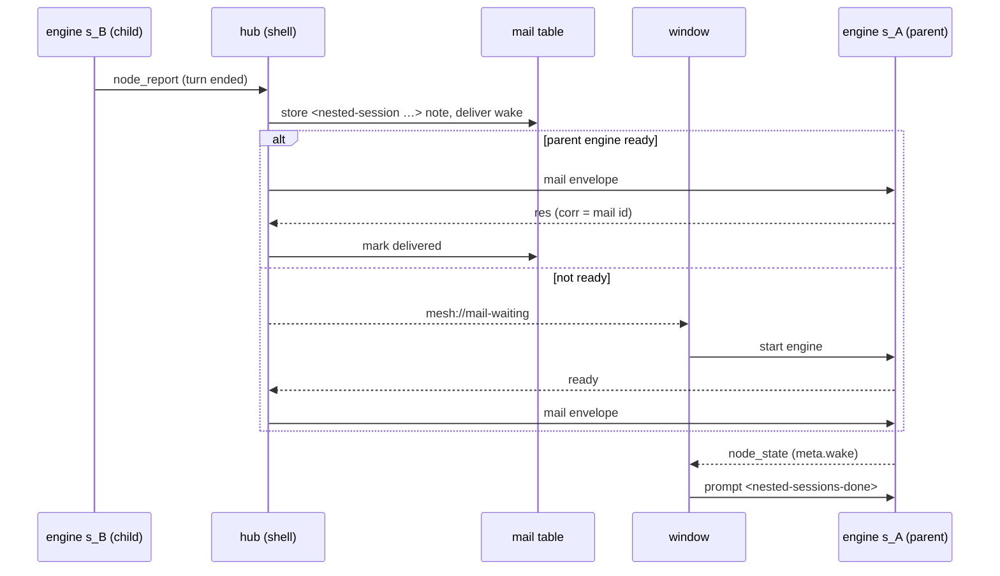

# Session mesh protocol — Plan

| | |
| --- | --- |
| Spec | [spec.md](spec.md) |
| Tasks | [tasks.md](tasks.md) |
| Updated | 2026-11-07 |
| ADD sections | [6.2 Sessions talking to sessions](../../architecture/README.md#62-sessions-talking-to-sessions) |
| ADRs | [0003 The engine runs as a child process, one per open chat](../../architecture/decisions/0003-engine-runs-as-a-child-process-per-chat.md) |

## 1. Context and constraints

The mesh builds on [subagents and nested sessions](../subagents-and-nested-sessions/plan.md):
the features existed, and this design replaces the ad-hoc plumbing under
them with one protocol. Paths are relative to the repository root.

Before the mesh, each "conversation that is not the one you are typing in"
had its own transport:

| Need | Before | Problem |
| --- | --- | --- |
| See a subagent's steps | Cumulative snapshot stuffed into `tool_execution_update.details.child` | Lossy (last 50 tools, 4 KB text), only reaches the direct parent's UI, not addressable |
| Know a background agent finished | Desktop polls `get_background_agents` once a second | Polling; no push event |
| Talk to a finished subagent | `message_agent` tool | Separate from sessions |
| Start / talk to a nested session | Desktop external tools `start_session` / `message_session` / `list_sessions` in `engine-store.ts` | Orchestration lives in the webview; breaks across windows |
| Tell a parent session a child finished | `recordFinishedTurn` → `queue_message` or automated `prompt` | Logic in the webview; notes lost if the parent is in another window |
| Plugin children | Host action `child_agent {start\|poll\|cancel\|dispose}` | Its own job table and polling |

Constraints:

- The shell already spawns every engine and relays its stdio
  (`apps/desktop/src-tauri/src/engine.rs`); it is the one place that sees all
  sessions and all windows ([ADR 0003](../../architecture/decisions/0003-engine-runs-as-a-child-process-per-chat.md)).
- The mesh runs over the existing `evo-protocol` framing (JSONL by default,
  CBOR frames optional).
- No engine runs when the app starts, so nothing asks for a host until a
  window starts one.

## 2. Architecture check

| Rule | Result | Notes |
| --- | --- | --- |
| The engine owns agent logic; the shell relays and provides native features | ok | The hub in the shell routes control, observation and mail between engines and windows and hosts sessions ([ADD 6.2](../../architecture/README.md#62-sessions-talking-to-sessions)); agent runs, tools and guards for in-process nodes stay in the engine's `LocalRouter`. |
| Layers point down; library crates stay free of engine/desktop concerns | ok | The wire types and the `Hub` live in `crates/evo-mesh` (pure logic, a `MailStore` trait), so the shell depends on the mesh without the engine crates; `evo_protocol::mesh` re-exports them. |
| Protocol changes update `evo-protocol`, the engine and the desktop together | ok | Wire types, engine RPC, `apps/desktop/src/engine/mesh.ts` and `engine-store.ts` changed together in each phase. |
| Models come from models.dev; no hardcoded model facts | n/a | No model data. |
| Real engine in the app; settings and credentials reload live | ok | The hub routes between real engines; "start without asking" reaches the hub through `mesh_configure`. |
| Untrusted input stays untrusted; permissions, sandbox and project trust stay in the path | ok | Mail is rendered as `<mail …>`, never as the user; reach and guards are enforced by the hub and router; agent-started sessions need approval unless the setting allows them. See 3.7. |
| Desktop UI structure and `DESIGN.md` | ok | Only `stores/engine-store.ts` talks to `engine/client.ts` (`EngineClient.mesh()`). |

## 3. Design

### 3.1 Overview

```text
 ┌──────────── desktop shell (Rust, Tauri) ─────────────┐
 │  Hub  (crate evo-mesh)                                │
 │  ├─ node registry (tree)      ├─ policy (caps, wake)  │
 │  ├─ router  s_* → engine      ├─ mailbox store (DB)   │
 │  └─ subscriptions (windows)   └─ proposals            │
 └────┬──────────────────┬──────────────────┬───────────┘
      │ stdio JSONL/CBOR │                  │ Tauri events
  engine s_A         engine s_B          windows (webviews)
  LocalRouter        LocalRouter
  ├─ s_A/a_1         (nested session,
  └─ s_A/a_2          parent = s_A)
```

- **Hub in the shell.** The hub is a transport-agnostic crate
  (`crates/evo-mesh`: registry, router, policy, a `MailStore` trait) embedded
  in the shell, so it can later run standalone for remote engines. It takes
  every engine stdout line and returns effects (`Send` a line to an engine,
  `MailWaiting`).
- **LocalRouter in the engine** (one per engine). Owns the in-process nodes
  (agents, side questions): the `agent` tool, plugin children and side
  questions register their nodes with a cancel handle and report state,
  activity, usage and reports. Mail between two agents of the same engine
  never leaves the process; everything else goes up to the hub.
- **Windows are subscribers**, not orchestrators. Starting a nested session,
  delivering notes and waking parents live in the hub, so a parent open in
  another window is reached.

Every running conversation is a **node**:

| Kind | Lives in | Durable | User can open it | Example |
| --- | --- | --- | --- | --- |
| `session` | its own engine process | yes (chat row + transcript) | yes | a chat, a nested session |
| `agent` | inside its host session's engine | no (kept a while for follow-ups) | read-only, nested under the tool call | `agent` tool, `delegate_task` |
| `side` | inside its host session's engine | no | read-only | side questions |

Three planes share one envelope: **control** (`cmd` → `res`),
**observation** (`evt`) and **mail** (`mail`).

### 3.2 Components

| Layer | Path | Responsibility | Requirements |
| --- | --- | --- | --- |
| crate | `crates/evo-mesh/src/wire.rs` | Wire types: envelope, `Address`, `Node`, `Level`, `MeshEvent` (`node_state`, `node_report`, `node_activity`, `node_usage`, `node_event`), `MeshCommand` (`subscribe`, `list`, `get`, `cancel`), `MailBody`, typed errors | FR-1, FR-2, FR-3, FR-5, FR-7, FR-8 |
| protocol | `crates/evo-protocol/src/mesh.rs` | Re-exports the `evo-mesh` wire types as `evo_protocol::mesh` | FR-3, FR-4 |
| crate | `crates/evo-mesh/src/hub.rs` | `Hub`: pure logic over engine stdout lines → effects; `MailStore` trait; notes from nested sessions; prompt mail; hosting; session tools (`session_tools()`), proposals, the running-children cap (`MAX_RUNNING_CHILDREN` = 8) | FR-17 – FR-25, NFR-1, NFR-2 |
| engine | `crates/evo-engine/src/mesh.rs` | `LocalRouter`: registry, per-subscriber levels, activity fold, cancel cascade, wake requests (`request_wake`, `session_run`), wait-for graph, `MAX_PAIR_MAIL` (20) | FR-1, FR-5 – FR-10, FR-12, FR-30, FR-31, NFR-2, NFR-3 |
| engine | `crates/evo-engine/src/mesh_tools.rs` | `send_message`, `ask`, `reply`, `list_nodes`, `cancel_node`, one instance per node | FR-26 – FR-29 |
| engine | `crates/evo-engine/src/agent_tool.rs`, `crates/evo-engine/src/child_agents.rs`, side questions | Register their nodes with the router and report state, activity, usage and reports | FR-1, FR-8 |
| engine | `crates/evo-engine/src/modes.rs`, `crates/evo-engine/src/rpc/protocol.rs` | RPC: `ready.mesh`, `{"type":"mesh",…}` lines, root-node state, a session's own `node_report`, mail addressed to the session | FR-4, FR-5, FR-9, FR-15, FR-16 |
| crate | `crates/evo-store/src/mail.rs`, `crates/evo-store/src/migrations/0006_mail.sql` | The `mail` table; `chats_with_pending_mail` | FR-17, FR-24, NFR-1 |
| desktop shell | `apps/desktop/src-tauri/src/mesh.rs` | Embeds the hub; `DbMailStore` (`create_session`); Tauri commands `mesh_session_tools`, `mesh_configure`, `mesh_start_session`, `mesh_hosted`, `mesh_pending_chats`; events `mesh://mail-waiting`, `mesh://host`, `mesh://prompted` | FR-17 – FR-24 |
| desktop shell | `apps/desktop/src-tauri/src/engine.rs` | Spawns engines, relays stdio, feeds every stdout line to the hub | FR-17 |
| desktop UI | `apps/desktop/src/engine/mesh.ts` | Mesh types and the fold into the agent view | FR-11 |
| desktop UI | `apps/desktop/src/engine/client.ts` | `EngineClient.mesh()` | FR-11 |
| desktop UI | `apps/desktop/src/stores/engine-store.ts` | Subscribes at `summary`, renders subagents, wakes idle chats, cancels through the mesh, keeps chats with running subagents, hosts engines (`onReadyNested`), restarts died engines, hosts chats with mail at startup | FR-11, FR-13, FR-14, FR-21 – FR-24, FR-28 |
| crate (planned) | `crates/evo-mesh`, `crates/evo-engine/src/mesh_tools.rs` | Mail between nodes of different engines | FR-32 |
| crate (planned) | `crates/evo-protocol/src/client.rs`, `crates/evo-mesh` | Hub over TCP for `--connect` and remote engines | FR-33 |

### 3.3 Interfaces

#### Node record

```jsonc
{
  "id": "s_01JC…/a_01JD…",       // address, see below
  "kind": "agent",
  "parent": "s_01JC…",           // lineage: who started it (may differ from host)
  "root": "s_01JA…",             // top of the lineage tree
  "depth": 1,
  "title": "Find auth call sites",
  "origin": "agent",             // user | agent  — who asked for it
  "state": "running",            // see 3.5
  "caps": ["mail.parent", "mail.siblings"],
  "budget": { "turns": 24, "costUsd": 0.5 },
  "usage": { "input": 0, "output": 0, "costUsd": 0 },
  "worktree": null
}
```

Session nodes carry wake requests in `meta`: `meta.wake` (addresses whose
reports wait), `meta.wakeTitles` and `meta.wakeReasons` (e.g. `mail`).

#### Address = location, parent = lineage

Two different things, deliberately kept apart:

- **Address** says *where the node runs* and therefore how to route to it.
  `s_<id>` is a session (one engine). `s_<id>/a_<id>` is an agent hosted in
  that engine; `s_<id>/a_<id>/a_<id>` if agents may nest. The hub routes on
  the first segment, the engine on the rest. No lookup table is needed to
  route.
- **Parent** says *who started it* and therefore who gets its reports and
  who may control it. A nested session has a top-level address (`s_B`, own
  engine) but `parent: s_A`.

Special addresses: `hub`, `client:<windowId>`, `topic:<name>` (topics: not
built).

#### Envelope

```jsonc
{
  "v": 1,
  "id": "m_01JE…",          // unique; idempotency key
  "kind": "cmd",            // cmd | res | evt | mail
  "op": "spawn",            // operation / event / mail type
  "from": "s_A",
  "to": "hub",
  "corr": null,             // res → its cmd; reply → its ask
  "seq": 1042,              // monotonic per sender; replay + ordering
  "ts": 1762400000000,
  "trace": { "root": "s_A", "cause": "m_01JD…", "hops": 1 },
  "body": { }
}
```

- `kind` splits the three planes: `cmd`/`res` = control, `evt` =
  observation, `mail` = conversation between nodes.
- `trace.cause` links every message to what caused it (a tool call, a mail),
  so loops and fan-out can be detected and the UI can draw causality.
- `trace.hops` is incremented on every relay; the hub drops at 16.

**Compatibility.** An engine that says `"mesh": 1` in `ready` speaks
envelopes. A message without an envelope is a legacy `RemoteEvent` /
`RemoteCommand` and is treated as `from`/`to` = the session's root node, so
current clients and engines keep working unchanged.

**RPC framing.** A `{"type":"mesh",…}` command line is answered with a `res`
envelope (`corr` = its `id`), then the replay; events go out as
`{"type":"mesh",…}` lines.

#### Control (`cmd` → `res`)

| op | body | result |
| --- | --- | --- |
| `spawn` | `kind`, `parent`, `title`, `brief`, `context: fresh\|fork`, `agentType?`, `model?`, `worktree?`, `background?`, `initiation: user\|agent`, `budget?` | `{node}` or `{state: "proposed", proposalId}` |
| `resolve_proposal` | `proposalId`, `accept: bool` | `{node?}` |
| `cancel` | `node`, `cascade: true` | `{cancelled: [ids]}` |
| `close` | `node` (release a retained agent, stop a session engine) | — |
| `detach` | `node` (session leaves its parent) | — |
| `resume` | `node` (reopen a session's engine from the DB) | `{node}` |
| `list` | `scope: children\|subtree\|root`, `of`, `states?` | `{nodes: […]}` |
| `get` | `node` | `{node}` |
| `subscribe` | `node`, `scope: self\|subtree`, `level`, `since?` | `{seq}` |
| `unsubscribe` | `subscription` | — |

The engine answers `subscribe`, `list`, `get` and `cancel` (the
`MeshCommand` set); the other ops are design.

Errors are typed: `not_found`, `forbidden` (caps), `budget_exceeded`,
`depth_exceeded`, `too_many_children`, `would_deadlock`, `timeout`.

#### Observation (`evt`)

Subscribers choose a **level**, so a sidebar does not pay for token deltas:

| level | events |
| --- | --- |
| `state` | `node_state`, `node_report`, `proposal_*` |
| `summary` | + `node_activity` (tool rows: `callId`, `name`, `subject`, `phase`; text tail), `node_usage` |
| `full` | + every existing `RemoteEvent` (`message_update`, `tool_execution_*`, …) with `from` = that node |

Core events:

```jsonc
{ "op": "node_state",  "body": { "node": { "id": "s_A/a_1", "state": "settled", "status": "done", … }, "prev": "running" } }
{ "op": "node_report", "body": { "node": "s_A/a_1", "turn": 3, "status": "done",
                                  "text": "…report…", "usage": { … }, "worktree": { "path": "…", "branch": "…", "kept": true } } }
{ "op": "node_usage",  "body": { "node": "s_A/a_1", "self": { … }, "subtree": { … } } }
```

- The **parent is always subscribed** to its children at `state` level; that
  subscription replaces the old notes and polling.
- `subscribe {since: seq}` replays from a per-node ring buffer (engine side)
  and, for sessions, the transcript; a gap answers `resync` with a snapshot.
- A `summary` subscription replays one `node_activity` per node with `rows`
  set (the whole list, replacing the subscriber's).
- `details.child` on the `agent` tool result stays, written once at the end,
  so a reopened chat still shows the finished child without the mesh.

#### Mail (`mail`)

How nodes talk. Three ops: `message`, `ask`, `reply`.

```jsonc
{ "kind": "mail", "op": "message", "from": "s_A/a_1", "to": "s_A/a_2",
  "body": { "content": [ { "type": "text", "text": "Schema is in db/0004.sql" } ],
            "deliver": "queue" } }
```

Between engines the hub sends `mail` envelopes with op `message` and a
`MailBody {text, deliver, title}`.

`deliver` decides what happens at the receiver:

| deliver | receiver running | receiver idle | maps to |
| --- | --- | --- | --- |
| `interrupt` | injected before its next model call | starts a turn (wake guard) | `queue_message steer` |
| `queue` | after the current turn, same run | held until its next turn | `followUp` / `nextTurn` |
| `wake` | like `queue` | starts a turn (wake guard) | automated `prompt` |
| `prompt` | a `queue_message` steer, read at the next step | an RPC `prompt` | the brief of a new session, `message_session` |

**ask / reply.** `ask` is mail that expects one `reply` with `corr` = the
ask's id. The asking tool call blocks (node state `waiting`) until the reply
or the timeout (default 600 s, max 1800 s). The receiver sees the question
with its id and answers with the `reply` tool; if the receiver is an agent
whose run ends without replying, its final text is the reply.

**Rendering into the model's context.** Mail never looks like the user:

```xml
<mail id="m_01JE…" from="s_A/a_1" title="Find auth call sites" origin="agent" kind="ask">
…content…
</mail>
```

The system prompt states that mail is information from another agent, not
an instruction from the user, and the transcript shows it as an event chip,
not a user bubble. Wake prompts the desktop sends: `<nested-sessions-done>`
(a nested session's note, chip "Session finished a turn") and
`<mail-arrived>` (chips "Message from …" / "Question from …"). A nested
session's report reaches the parent as a `<nested-session …>` note.

#### Model-facing tools

A small, uniform set, each one mesh op underneath:

| Tool | Mesh op | Replaces |
| --- | --- | --- |
| `agent {description, prompt, agentType?, model?, isolation?, background?}` | `spawn kind=agent` | same name |
| `start_session {title, prompt, context, worktree?, model?}` | `spawn kind=session initiation=agent` | external tool |
| `send_message {to, message, deliver?}` | `mail message` | `message_agent`, `message_session` |
| `ask {to, question, timeoutSec?}` | `mail ask` (blocks) | — (new) |
| `reply {askId, answer}` | `mail reply` | — (new) |
| `list_nodes {scope?}` | `list` | `list_sessions`, `get_background_agents` |
| `cancel_node {node}` | `cancel` | `cancel_background_agent` |

Old names stay as aliases for one release. `to` accepts `parent`, a node
id, an agent id, or a title the caller can see in `list_nodes`.

`start_session`, `message_session` and `list_sessions` are defined by the
hub (`session_tools()`), fetched by the window through `mesh_session_tools`
and registered on top-level chats, and answered by the hub: the window
ignores their `external_tool_request`s. `start_session` returns a
`proposal_…` id unless it starts at once.

#### Tauri commands and events

| Name | Kind | Use |
| --- | --- | --- |
| `mesh_session_tools` | command | the hub's session tool definitions |
| `mesh_configure` | command | passes Settings → Sandbox → start without asking |
| `mesh_start_session` | command | a proposal card's **Start** |
| `mesh_hosted` | command | a window has set up the engine's tools for a chat |
| `mesh_pending_chats` | command | chats with undelivered mail (archived excluded) |
| `mesh://mail-waiting` | event | mail waits for a chat whose engine is not ready |
| `mesh://host {chat, cwd, restore}` | event | the hub needs an engine set up for a chat |
| `mesh://prompted` | event | the hub prompted a chat (the engine does not echo a run's first prompt) |
| `chat://updated` | event | a session the hub created |

### 3.4 Data and storage

| | sessions | agents |
| --- | --- | --- |
| Mail guarantee | at-least-once, deduplicated by `id` | at-most-once (in memory) |
| Ordering | per (from, to) by `seq` | per (from, to) by `seq` |
| Survives engine restart | yes (DB) | no |
| Events replay | ring buffer + transcript | ring buffer while retained |

Designed migration in `crates/evo-store`:

```sql
CREATE TABLE mail (
    id          TEXT PRIMARY KEY,
    from_node   TEXT NOT NULL,
    to_node     TEXT NOT NULL,
    op          TEXT NOT NULL CHECK (op IN ('message', 'ask', 'reply')),
    corr        TEXT,
    deliver     TEXT NOT NULL,
    body        TEXT NOT NULL,           -- JSON
    state       TEXT NOT NULL DEFAULT 'pending'
                CHECK (state IN ('pending', 'delivered', 'failed', 'expired')),
    created_at  INTEGER NOT NULL,
    delivered_at INTEGER
);
CREATE INDEX mail_pending ON mail (to_node, state, created_at);

CREATE TABLE proposals (
    id TEXT PRIMARY KEY, parent_chat_id TEXT NOT NULL, spec TEXT NOT NULL,
    state TEXT NOT NULL DEFAULT 'open', created_at INTEGER NOT NULL, expires_at INTEGER NOT NULL
);
```

The built table differs (see 5). Session nodes reuse `chats`
(`parent_chat_id`, `origin` already exist).

In memory: the engine's router keeps every node's activity (turns, tool
uses, last 50 tool rows, text tail) even with no subscriber; agents are
retained for follow-up mail after they settle; the hub tracks each engine's
`agent_start` / `agent_settled` and whether a window has hosted it.

### 3.5 Behaviour

#### Lifecycle

```text
 proposed ──accept──▶ starting ──▶ running ◀──▶ waiting (ask / approval)
     │                               │  ▲
  reject/expire                 turn end│  │ mail (interrupt|wake)
     ▼                               ▼  │
  dismissed                          idle ──────────────┐
                                     │                  │ (sessions only:
                       done | failed | cancelled        │  idle is normal,
                                     ▼                  │  they wait for input)
                                  settled ──close/evict──▶ closed
```

- **Agents**: `running` → `settled` when the run ends; kept (retained) for
  follow-up mail for N idle minutes, then `closed`.
- **Sessions**: alternate `running` ⇄ `idle` forever; `closed` only when
  archived or deleted. The root node is `running` from an accepted prompt
  until `agent_settled`, then `idle`. A `node_report` is emitted on every
  turn end (not for compactions), with the status from the run's outcome
  and its final text.
- **Cancellation cascades** down the lineage tree by default, children
  first. Deleting a parent session *detaches* its child sessions (they move
  to the top level) but cancels its agents.

#### Background agent reports and wakes

When a background agent's report is queued for an idle parent, the engine
adds the agent's address to the parent session node's `meta.wake` and
announces the node (`LocalRouter::request_wake`). Any run of that session
reads the queued reports, so the list clears when a run starts
(`mesh::session_run`); no ack is needed, and a window that reloads sees the
pending list in the replay.

The desktop (`engine-store.ts`), on a session node's `node_state` (and on
`agent_settled`), waits 1 s for events to settle, then wakes an idle chat
for the `meta.wake` reports it has not handled yet (`address@endedAt`),
with the limit of 5 automated wakes in a row. Cancelling an agent sends
mesh `cancel`. An idle chat whose subagents still run is not stopped by the
idle-engine trim.

#### Mail to a session

A `mail` envelope addressed to a session is queued like a steering message
(running) or for the next run (idle); `deliver: wake` then adds a wake
request (`meta.wake` + `meta.wakeTitles`), exactly like a background
agent's report. The engine answers with `res` (`corr` = mail id) and drops a
mail id it already took.

#### Nested session notes



The hub sees every engine's stdout. A nested session's `node_report`
becomes a `<nested-session …>` note mailed to its parent with `wake`, stored
in the `mail` table, written to the parent's engine if it is ready, and
marked delivered when that engine answers. Otherwise the windows hear
`mesh://mail-waiting`; the main window starts the parent's engine and the
hub sends the mail on its `ready`. Unanswered mail is sent again after a
restart (at least once). Reports the engine replays to a new subscriber are
recognised by envelope id and not mailed twice. The note wakes the parent
through the same `meta.wake` path as background agents.

#### Session tools and hosting

- `start_session` proposes (a `proposal_…` id in the tool result) or, with
  Settings → Sandbox → start without asking (`mesh_configure`), starts at
  once. A proposal card's **Start** calls `mesh_start_session`. Starting
  creates the chat in Rust (`DbMailStore::create_session`: chat row, fork,
  worktree), announces it as `chat://updated`, and mails the child its brief
  with `deliver: prompt`. At most 8 children of a chat run at once; nested
  sessions get no session tools.
- **Prompt mail** waits until a window has *hosted* the receiving engine
  (set up its tools and called `mesh_hosted`), then goes out as an RPC
  `prompt` (idle) or `queue_message` steer (busy: read at the session's next
  step, not after its run; the hub tracks `agent_start` / `agent_settled`).
  A refused prompt goes out when the run ends. Accepted = delivered. The
  engine does not echo a run's first prompt, so the hub also emits
  `mesh://prompted` and the window showing the chat adds the turn.
- **Hosting.** When the hub needs an engine that is not set up — a session
  it just created, a chat with waiting mail, an engine that exited with mail
  pending — it emits `mesh://host {chat, cwd, restore}`. A window that holds
  the chat answers `mesh_hosted`; otherwise the main window starts the
  engine in the background, and `onReadyNested` calls `mesh_hosted` once the
  tools are set up. Windows still start, hold and trim engines.
- **Mail left at startup.** The main window reads the chats with
  undelivered mail (`mesh_pending_chats`,
  `evo_store::mail::chats_with_pending_mail`, archived chats excluded) and
  hosts each one.
- `list_sessions` reads the children from the database and their live state
  from the hub (`running`, `waiting` for an approval, `idle`).

#### Peer messaging (within one engine)

`send_message`, `ask`, `reply`, `list_nodes` and `cancel_node` exist for the
session and for every subagent. Each agent gets its own instances bound to
its node (passed as the child's tool replacements; agent types that narrow
tools keep them), so a call knows who calls; the session's instances refuse
calls from other children (plugin children).

- **Delivery**: a `<mail id from title kind>` user message. A running
  receiver gets it before its next model call (steer); an idle session gets
  it with its next run plus a wake request with reason `mail`
  (`meta.wakeReasons`; the desktop wakes it with `<mail-arrived>`); an idle
  agent gets it when continued.
- **ask / reply**: `ask` blocks until `reply {askId}`, the receiver's run
  ending (its final text answers), the timeout or cancellation. An `ask` to
  an idle agent continues it in the background to answer; that run's report
  goes to the asker, not to the parent.

#### Example: two parallel agents, one asks the parent

```text
s_A (parent)            engine A LocalRouter              s_A/a_1        s_A/a_2
  │ agent×2 (background)──▶ spawn a_1, a_2 ─────────────────▶ running      running
  │◀── node_state running ×2
  │ (turn ends, idle)
  │                                         a_1: send_message {to: a_2, "schema is in 0004"}
  │                         route locally ───────────────────────────────▶ mail(queue)
  │                                         a_2: ask {to: parent, "keep column or rename?"}
  │◀── mail ask (wake) ── hub wake guard: parent idle → automated turn
  │ reply {askId, "rename"} ──────────────────────────────────────────────▶ resumes
  │◀── node_report a_1 (done)  ◀── node_report a_2 (done)  → coalesced wake
```

### 3.6 Errors and edge cases

- Commands fail with the typed errors of 3.3.
- **Engine death (design).** If an engine dies, the hub marks its session
  `failed {reason: "engine_exit"}` and its agents `failed`; pending mail to
  the session stays in the store.
- **Hosting an engine that died.** A window that holds a chat whose engine
  exited or failed to start (a crash) starts it again when the hub asks for
  a host, at most 3 times in 2 minutes per chat (an engine that dies on
  start is not restarted forever; its mail then waits until the chat is
  opened). Without this, `message_session` reported "sent" while the mail
  waited for good.
- **Refused prompt**: sent again when the receiver's run ends.
- **Replayed reports**: recognised by envelope id, not mailed twice.
- **Duplicate mail id**: the engine drops a mail id it already took.
- **`ask` timeout**: default 600 s, max 1800 s; the call returns on timeout
  or cancellation.
- **Relay loops (design)**: the hub drops a message at `trace.hops` 16.
- **Subscriber gap (design)**: `subscribe {since}` with a gap answers `resync` with a
  snapshot.

### 3.7 Security and trust

Policy is enforced by the hub and the `LocalRouter`, never by the model.

**Capabilities — narrow-only inheritance.** A child gets at most its
parent's capabilities; `spawn` may narrow them.

| cap | default for agents | default for agent-started sessions |
| --- | --- | --- |
| `mail.parent`, `mail.children` | yes | yes |
| `mail.siblings` | yes | no |
| `mail.tree` (anyone under the same root) | no | no |
| `spawn.agent` | no (no recursion) | yes |
| `spawn.session` | no | no |
| `spawn.session.auto` (no proposal) | no | Settings → Sandbox |
| `topic:<name>` publish / subscribe | no | no |

Mail never crosses root trees without the user. As built, a node writes to
its parent, its children and — with `mail.siblings`, which agents get — its
siblings; never another tree.

**Approval (design).** `spawn {kind: "session", initiation: "agent"}` without
`spawn.session.auto` returns `proposed`; the hub stores the proposal
(expires after 7 days) and emits `proposal_created`; the UI shows the card —
the same path as the earlier proposal cards, now owned by the hub.

**Mail is not the user.** Mail is rendered as `<mail …>` and shown as an
event chip (3.3); the session's tools refuse calls from other children.

**Wake guard and loop breaker (design; as built where noted).**

- Coalesce wakes for 2 s into one automated turn.
- At most 5 automated turns in a row on a node without a user message;
  after that, mail waits for the user.
- No wake while the user has a draft in that chat, or on an archived chat.
- **Ping-pong breaker**: more than 20 mails between the same two nodes with
  no user input pauses both (`waiting {reason: "loop"}`) and surfaces it.
  As built: at most `MAX_PAIR_MAIL` (20) messages per directed pair between
  two runs of the session.
- **Deadlock guard**: the wait-for graph holds every open `ask` and every
  foreground `agent` call (the session waits on that agent); an `ask` that
  would close a cycle is refused (`would_deadlock`) — e.g. a foreground
  agent asking its session.

### 3.8 Configuration

| Setting | Type | Default | Stored | Applies |
| --- | --- | --- | --- | --- |
| Settings → Sandbox → start without asking (`autoStartSessions`) | boolean | off (sessions are proposed) | UI store (`apps/desktop/src/stores/ui-store.ts`) | live: `engine-store.ts` passes each change to the hub with `mesh_configure` |

Limits and budgets (design):

- `maxDepth` (default 2), `maxChildren` per node (8 sessions, 16 agents),
  `maxConcurrent` foreground agents per run (4).
- `budget {turns, tokens, costUsd, wallClockSec}`: a child's budget is at
  most its parent's remainder. Usage rolls up (`node_usage.subtree`);
  exceeding it settles the node with `failed {reason: "budget"}`.

Built limits: 8 running children per chat; 20 mails per directed pair
between two runs; `ask` timeout 600 s (max 1800 s); 5 automated wakes in a
row; 3 engine restarts in 2 minutes per chat; 50 tool rows per node's
activity.

## 4. Alternatives considered

| Option | Why not |
| --- | --- |
| Keep one mechanism per need (snapshots, polling, webview tools, webview notes, plugin job table) | Lossy, polling, breaks across windows, no sibling talk, nothing survives a restart (see 1). |
| Hub as a separate daemon that the shell and remote clients both connect to | The shell already spawns and relays every engine; the hub is embedded there as a transport-agnostic crate that can later run standalone. |
| An ack command for background-agent reports | Not needed: wake requests live on the session node and clear when a run starts. |
| Orchestrating nested sessions in the webview | Breaks when the parent is open in another window; the hub owns it. |

## 5. As-built notes

Status of the build plan: phases 1–4 built (phase 4 within one engine);
phase 5 (remote engines) proposed. The phases are in [tasks.md](tasks.md).

Phase 1:

- The wire types first lived in `crates/evo-protocol/src/mesh.rs`.
- The design had the `LocalRouter` replace the separate job tables of
  `child_agents.rs`, `agent_tool.rs` and the background-agent list. As
  built, their own job tables stay (they hold the harness handles); the
  router is the shared registry and event source.
- The desktop subscribes at `summary` on `ready` (and when it attaches to an
  engine that already runs) and renders subagents from `node_*` events.

Phase 2:

- No polling. The RPC commands `get_background_agents`,
  `ack_background_agents` and `cancel_background_agent` are gone; the agent
  registry no longer keeps a wake flag.

Phase 3:

- The wire types moved to `crates/evo-mesh` (`evo_protocol::mesh` re-exports
  them) so the shell can depend on the mesh without the engine crates.
- The webview no longer builds or queues notes (`recordFinishedTurn`,
  `pendingNotes`, `flushNotes` are gone). Restored transcripts no longer
  show an empty turn for a queued report.
- The built `mail` table (`0006_mail.sql`) is simpler than the design in
  3.4: `id`, `from_chat`, `to_chat` (references `chats`, deleted with it),
  `body` (the envelope body, JSON), `created_at`, `delivered_at`, with a
  partial index on undelivered mail. There is no `proposals` table;
  proposals stay `proposal_…` ids in the tool result (checked against the
  migrations on 2026-11-07).

Phase 4:

- Built within one engine. Not built: mail between nodes of different
  engines (sessions talk through notes and `message_session`), topics,
  budgets and depth limits beyond "no recursion".

Differences from the design:

- Each subscriber has its own level; the router builds events up to the
  highest live one. `node_state`'s body carries the whole node record.
- Legacy engine events are not tagged with `from`: they all belong to the
  root, which the design allows. Hosted nodes' raw events are `node_event`
  at the `full` level (side questions do not send them yet).
- Side questions close as soon as they settle (they are one-shot).
