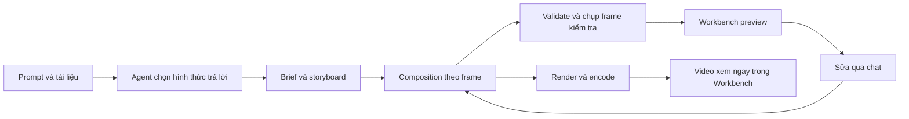

# Research: motion graphics và video từ code cho EvoFlux

**Ngày kiểm tra:** 2026-10-15

**Baseline nội bộ:** `feat/intelligent-ui`, commit `2fc39d7ce`

**Trạng thái:** Nghiên cứu tham khảo; đã triển khai lát cắt frame export bằng Mediabunny trong nhánh feature. Desktop/WebView smoke và so sánh engine vẫn chưa hoàn tất.

## 1. Kết luận phục vụ quyết định

EvoFlux cần phát triển đồng thời hai phần: **khả năng thiết kế motion của agent** và **pipeline dựng video có thể kiểm chứng**. Một thư viện animation hoặc nút Export riêng lẻ không giải quyết cả hai.

Đề xuất nghiên cứu tiếp bằng một thử nghiệm có giới hạn:

1. **Ưu tiên thử HyperFrames** cho đường HTML/SVG/CSS → preview → MP4, vì gần hợp đồng `source_html` đang có.
2. **Dùng Remotion làm đối chứng** cho đường React/TSX → player → video. Đây là ứng viên mạnh nếu chấp nhận điều kiện phân phối, telemetry và chi phí runtime của phương án cụ thể.
3. **Đã chọn Canvas + Mediabunny cho lát cắt đầu tiên** của explainer 2D do EvoFlux kiểm soát: canvas được seek trong iframe sandbox, bitmap chuyển từng frame qua bridge, Mediabunny đóng gói MP4/WebM bằng WebCodecs. HyperFrames/FFmpeg vẫn là phương án tham khảo nếu cần timeline nhiều track, composition HTML rộng hơn hoặc render backend.

Đây là lựa chọn triển khai ban đầu dựa trên ranh giới runtime hiện tại, chưa phải kết luận benchmark. Gói Mediabunny đã được tích hợp nhưng chưa có desktop smoke, video fixture được xem, hoặc số đo trên Tauri WebView. Không xem các tuyên bố hiệu năng từ upstream là kết quả trên EvoFlux.

## 2. Claude công khai điều gì?

Thông báo ngày 2026-10-08 mô tả Claude Motion tạo animation bằng code cho text, chart, shape và image; người dùng sửa trong editor hoặc qua chat, sau đó tải MP4. Đây là animation từ nội dung có thể sửa, không dùng model tạo footage. [Thông báo Anthropic][S01]

Help Center xác nhận đầu vào từ chat hoặc Motion template, khuyến khích nêu người xem, nơi phát, thời lượng và cung cấp tài liệu nguồn. [Hướng dẫn Claude Motion][S02]

Anthropic công bố thao tác export MP4 nhưng tài liệu chính thức không nêu FFmpeg, Remotion, HyperFrames hay renderer nội bộ. [Hướng dẫn Claude Motion][S02]

Có một dịch vụ độc lập cũng tên *Claude Motion* dành cho Claude Code/Codex; trang About của chính dịch vụ nói rõ không liên quan Anthropic và nói video của họ render bằng timeline HyperFrames. Đây là bằng chứng về workflow bên thứ ba, không phải kiến trúc Claude.ai. [Claude Motion độc lập][S32]

Một workflow Claude Code khác do cộng đồng công bố ghép HTML/GSAP, HyperFrames để lấy frame và FFmpeg để encode MP4. HyperFrames mô tả chính xác pipeline seek từng frame, capture bằng Chrome rồi encode/mix audio với FFmpeg. Điều này nhiều khả năng là thứ bạn nhớ, nhưng vẫn không cho biết renderer Claude Motion chính thức dùng. [Ví dụ workflow][C05], [HyperFrames determinism][S04]

Mục tiêu trải nghiệm cho EvoFlux: mô tả ý tưởng → xem ngay trong Workbench → sửa chi tiết bằng chat → xuất file. Việc chọn engine là quyết định riêng của EvoFlux.

## 3. So sánh các cách làm

Các nhận xét “phù hợp EvoFlux” dưới đây là suy luận từ code hiện tại và tài liệu upstream.

| Cách làm | Authoring / preview / export được công bố | Điểm mạnh cho EvoFlux | Việc cần chứng minh |
|---|---|---|---|
| **HyperFrames** | HTML với clip có timing; Player; CLI/Producer/Engine để render | Gần `source_html`, có công cụ agent và kiểm tra frame | Nhúng vào sandbox hiện tại, runtime local, asset paths, Windows packaging |
| **Remotion** | React composition theo frame; Player; renderer Node và web-renderer | Hợp React/TS, có skill và ví dụ AI chính thức | Compilation isolation, preview/export parity, license và telemetry |
| **Motion Canvas** | TypeScript generator; editor preview; exporter FFmpeg | Vector explainer và đồng bộ voice-over | Adapter vào Workbench, đóng gói Node/Vite/exporter |
| **Revideo** | TypeScript scene; React Player; API render headless | Có hướng tích hợp ứng dụng và audio/video | API/version hiện tại; tránh dùng ví dụ lịch sử không còn tương thích |
| **Manim Community** | Python scene → video | Giải thích toán, hình học và biến đổi | Runtime đồ họa/font, trải nghiệm sửa/preview, cô lập mã Python |
| **Canvas + Mediabunny** | EvoFlux định nghĩa scene; toolkit ghi/encode/mux media | Có thể bổ sung vào canvas runtime đang có | Tự xây authoring, layout, timing, caption và adapters |

Nguồn cho các bề mặt tích hợp: [HyperFrames][S03], [Remotion Player][S09], [Remotion renderer][S10], [Motion Canvas][S15], [Revideo][S18], [Manim][S19], [Mediabunny][S21]. Không so sánh bằng số GitHub stars.

### 3.1 HyperFrames: ứng viên gần EvoFlux nhất về định dạng

Composition có viewport, thời lượng, clip và runtime seek được. Player phục vụ playback; SDK sửa source; Producer/Engine phục vụ capture và encode. Có thể bắt đầu bằng CLI thay vì nhúng toàn bộ editor. [Developer overview][S03]

Renderer hỏi từng frame, seek timeline rồi capture bằng Chrome và encode bằng FFmpeg. Fonts và browser khác nhau vẫn có thể làm pixel khác nhau giữa máy; upstream đề xuất môi trường được pin khi cần tái lập chặt. [Determinism][S04]

Repo có skill cho workflow và domain; đây là tham khảo để tổ chức kiến thức agent, không phải chỉ thêm một prompt “make a video”. [Repo chính thức][S05]

**Điểm tích hợp cụ thể:** adapter editor `createIframePreviewAdapter` yêu cầu same-origin. EvoFlux hiện cố ý dùng iframe opaque origin. Không thể copy nguyên adapter đó vào app; cần đánh giá Player/bridge riêng và giữ ranh giới cô lập. [SDK integration][S06]

### 3.1.1 FFmpeg nằm ở đâu trong workflow?

Trong pipeline HyperFrames, FFmpeg là encoder/muxer ở cuối đường render; Chromium/Chrome tạo frame sau khi timeline được seek tới từng số frame. FFmpeg không phải animation engine và không tự làm preview seekable. Một video export tốt cần cả composition có thể seek, frame capture ổn định, rồi encoder/muxer. [Determinism][S04]

Điều này cũng giải thích vì sao `canvas.captureStream()` chưa tương đương: nó ghi theo đồng hồ playback của browser, không dựng từng frame đã chốt. EvoFlux hiện có đường frame-based cho artifact đăng ký `registerFrameRenderer(timeMs)`. Nó dùng WebCodecs/Mediabunny tại chỗ và không cần cài FFmpeg. HyperFrames vẫn đáng thử nếu cần timeline nhiều track hoặc hỗ trợ composition HTML tổng quát; khi đó cần đo dung lượng, license binary cụ thể, startup, CPU/RAM và tương thích từng WebView trước khi đóng gói Chromium/FFmpeg.

### 3.2 Remotion: ứng viên React với hai đường export

Composition nhận frame number và tạo hình ảnh; logic không nên phụ thuộc thứ tự render hay đồng hồ thực. Điều này cũng giúp seek và sửa từng cảnh. [Core idea][S07], [Flickering guide][S08]

Ngoài renderer Node, hiện có `@remotion/web-renderer` sử dụng WebCodecs/Mediabunny. Không nên giả định mọi composition React đều xuất giống preview: đường web có giới hạn CSS/elements; chế độ HTML-in-canvas có điều kiện hỗ trợ riêng. [Client rendering][S11], [Limitations][S12]

Hướng dẫn AI chính thức dùng output có schema và kiến thức chuyên biệt nạp theo tác vụ; repo skills tách create/markup/render và các domain. Đây là tham khảo sát vấn đề model MiMo của EvoFlux. [Code generation][S13], [Skills][S14]

### 3.3 Motion Canvas và Revideo

Motion Canvas dùng generator TypeScript cho animation vector và có editor preview. Exporter FFmpeg nhận frame từ browser sang Node và hỗ trợ audio đã cấu hình trong project. [Introduction][S15], [Exporter][S16], [Plugin architecture][S17]

Revideo hiện có React Player, headless API và audio/video frame synchronization. URL cũ `redotvideo/revideo` chuyển sang `midrender/revideo`. Cần kiểm tra phiên bản mới khi thử; thảo luận năm 2024 chỉ có giá trị lịch sử. [Repo][S18]

Đánh giá: hai hướng này phù hợp để đối chiếu các explainer có nhiều vector và audio. Chưa có bằng chứng rằng chúng nhẹ hơn hoặc khó hơn Remotion/HyperFrames trên EvoFlux; cần đo cùng fixture.

### 3.4 Manim Community

Đây là lựa chọn chuyên biệt cho math/science animation. ManimCE và ManimGL là các dự án khác nhau, không trộn API hoặc hướng dẫn cài. Với EvoFlux, nên cân nhắc như adapter theo nhu cầu thay vì dependency cho mọi người dùng. [ManimCE repo][S19], [Installation][S20]

### 3.5 Canvas + Mediabunny và vai trò của GSAP

Mediabunny cung cấp media sources, timestamp, encoding và muxing; `CanvasSource` nhận hình canvas tại thời điểm được thêm vào output. Nó không tự thiết kế scene hay typography. [Writing media][S22], [Media sources][S23]

GSAP là công cụ animation timeline có thể seek; nó không tự cung cấp toàn bộ pipeline video. Có thể dùng nguyên tắc timeline được pause rồi seek theo frame, nhưng vẫn cần renderer và encoder. [GSAP seek][S24]

Đánh giá: Canvas/Mediabunny phù hợp nhất với contract canvas hiện có. EvoFlux hiện đã có frame protocol và encode path đầu tiên: HTML sandbox đăng ký hàm vẽ thuần theo thời gian tuyệt đối; app hỏi từng timestamp, nhận một `ImageBitmap` rồi ghi timestamp cố định. Full DOM/SVG và multi-track chưa được hỗ trợ; đây không phải benchmark và chưa xác nhận trên mọi desktop WebView.

## 4. Repo, license và điều kiện tích hợp

Snapshot lấy trực tiếp từ GitHub API ngày nghiên cứu. SHA là mốc khảo sát, **không phải version đã chọn để phân phối**. Cả bảy repo trả về `archived=false` khi kiểm tra; ngày commit cuối không phải bằng chứng về SLA hay mức hỗ trợ.

| Repo / snapshot | Ngày commit UTC | License ghi nhận |
|---|---|---|
| [heygen-com/hyperframes @ c694785d](https://github.com/heygen-com/hyperframes/tree/c694785df5993191fec42ec84e9d65ea69f98ad8) | 2026-10-15 | Apache-2.0 |
| [remotion-dev/remotion @ 5b322e7c](https://github.com/remotion-dev/remotion/tree/5b322e7cf62a9018c37c8ed47fd31822df3822c2) | 2026-10-14 | Custom Remotion terms; API trả `NOASSERTION` |
| [remotion-dev/skills @ 7ba4dcf8](https://github.com/remotion-dev/skills/tree/7ba4dcf8ebe1626b00baa41e1f2478113719b60b) | 2026-10-12 | API không nhận diện license; chưa xác nhận quyền vendor nội dung |
| [motion-canvas/motion-canvas @ 7b91435c](https://github.com/motion-canvas/motion-canvas/tree/7b91435c301d530351dcf5ebb91dd139c002e405) | 2026-07-02 | MIT |
| [midrender/revideo @ b5de67a0](https://github.com/midrender/revideo/tree/b5de67a009a55aa2768a1e178b0446b2479a0b4e) | 2026-07-15 | MIT |
| [Vanilagy/mediabunny @ 35a379c9](https://github.com/Vanilagy/mediabunny/tree/35a379c984b4a36a0de3f5c1e26d4867baa32670) | 2026-10-14 | MPL-2.0 |
| [ManimCommunity/manim @ 622520d3](https://github.com/ManimCommunity/manim/tree/622520d34190062f32d68af066c80f1c937fc8bf) | 2026-10-12 | MIT |

Những điều tác động trực tiếp tới lựa chọn:

- Remotion tự mô tả là **source-available**, không phải OSI open source. FAQ phân biệt dịch vụ render mã AI tạo với dịch vụ nhận mã Remotion người dùng đem tới. Web rendering được công bố có telemetry mặc định không tắt được; phải kiểm tra đường render đã chọn trước khi cam kết offline. [License FAQ][S25]
- HyperFrames dùng Apache-2.0 nhưng dependency có điều kiện riêng. GSAP Standard License có giới hạn với một số công cụ xây animation qua giao diện trực quan; chưa xác định EvoFlux thuộc trường hợp nào. Ghi lại điểm cần làm rõ trước khi chọn mặc định. [GSAP license][S26]
- Mediabunny công bố MPL-2.0 và nghĩa vụ công khai thay đổi nếu sửa rồi phân phối source được cấp phép của thư viện. [Repo/license][S21]
- Nếu phân phối FFmpeg, ghi nhận chính xác build và license dependency của binary, không suy từ tên FFmpeg. [FFmpeg upstream][S27]

Các ghi chú này ghi nhận điều kiện do tác giả công bố; chưa kết luận quyền phân phối của sản phẩm EvoFlux. Không cài skill ngoài hoặc sao chép nội dung skill vào repo trong nghiên cứu này.

## 5. Bàn luận cộng đồng: dùng để đặt giả thuyết kiểm thử

| Nguồn đã đọc | Quan sát / ý kiến của người đăng | Hàm ý thử nghiệm cho EvoFlux |
|---|---|---|
| [Remotion Videos in Claude][C01] | Tạo và render được nhưng kết quả vẫn giống slide, thiếu độ sâu và độ mượt về thiết kế | “Video encode thành công” và “motion hữu ích/đẹp” phải được chấm riêng |
| [Claude + Remotion + Figma MCP][C02] | Người đăng thiết kế scene trước; bình luận nhấn mạnh sửa chi tiết và cấu trúc modular | Test sửa một con số hoặc timing mà không làm đổi toàn bộ video |
| [Kinh nghiệm HyperFrames][C03] | Tác giả cho rằng storyboard, visual metaphor và hướng dẫn motion cải thiện kết quả | So sánh prompt tối thiểu với skill có ví dụ và quy trình xem frame |
| [Show HN: Revideo, 2024-06-11][C04] | Tác giả bàn về reusable code, render API và khác biệt với Motion Canvas thời điểm đó | Đánh giá bề mặt nhúng vào ứng dụng, không chỉ demo CLI |

Đây là trải nghiệm tự báo cáo, có thể có lựa chọn mẫu và quảng bá. Không dùng để xếp hạng model, khẳng định thời gian sản xuất, hoặc suy luận model nào tốt hơn. Một số bài chỉ hiện thời gian tương đối; không tự suy thành ngày phát hành chính xác. Chưa xác minh các clip đính kèm bằng visual QA.

## 6. Đối chiếu EvoFlux đang có

Các dòng sau là quan sát code tại baseline, chưa phải kết quả chạy desktop:

| Vùng code | Đã có | Khoảng trống cần đưa vào plan |
|---|---|---|
| [MotionArtifact](../../web/src/components/visual-artifact/MotionArtifact.tsx) | Play/pause/restart/seek, nút export, pause khi tab inactive | Chưa có render-job lifecycle, tiến độ/cancel và trạng thái export đầy đủ |
| [VisualArtifactFrame](../../web/src/components/VisualArtifactFrame.tsx) | Sandbox + MessageChannel; ghi canvas 30 fps qua MediaRecorder | `export_request` không restart/seek scene; recorder dừng theo timer 120000 ms, chưa theo `duration_ms`; `reportPlayback('ended')` chỉ gửi trạng thái |
| Cùng bridge | Có chunk giới hạn và ngưỡng 150 MB | Chưa có cơ chế frame acknowledgment để export chờ frame hoàn tất; encode lỗi có thể không tới UI |
| [Event schema](../../app/agent/schemas/events.py) | Motion yêu cầu HTML và duration, giới hạn source 200 KB | Chưa xác nhận mã thực hiện seek hoặc có marked canvas; mô tả tool không thay thế validation runtime |
| [MotionArtifact tests](../../web/src/__tests__/components/MotionArtifact.test.tsx) | Mock bridge, test lệnh điều khiển và tab inactive | Chưa chứng minh file video thật có đúng duration/fps/nội dung |
| [Workbench](../../web/src/components/workbench/VisualArtifactWorkbench.tsx) | Preview trong app, source export/save có chủ đích | Là bề mặt tái sử dụng cho video preview và kết quả render |

Hệ quả: motion/export hiện tại là nền tảng thử nghiệm. Chưa đủ bằng chứng để gọi đây là pipeline video hoàn chỉnh. Record một canvas cũng có thể bỏ qua caption hoặc layer HTML nằm ngoài canvas. [Canvas capture API][S28]

## 7. Những nguyên tắc thiết kế rút ra

Phần này là **đề xuất cho EvoFlux**, chưa phải hợp đồng đã chấp nhận.

### 7.1 Một nguồn thiết kế, hai cách tiêu thụ

Preview và export dùng cùng composition và frame clock. Render frame 90 phải cho cùng trạng thái dù trước đó xem frame 30 hay 120. Export cần chờ assets, fonts và frame hoàn tất. Không dùng việc “đã chạy đủ N giây” làm bằng chứng scene đúng.



### 7.2 Manifest đủ để sửa và tái tạo

Hướng data shape để plan chi tiết tiếp, không ép tất cả engine dùng một scene DSL mới:

```ts
type MotionProjectManifest = {
  version: 1;
  artifactId: string;
  revision: number;
  runtime: { id: string; version: string };
  width: number;
  height: number;
  fps: number;
  durationInFrames: number;
  entrypoint: string;
  assets: Array<{ id: string; contentHash: string; mediaType: string }>;
  scenes: Array<{ id: string; startFrame: number; durationInFrames: number }>;
  themeSnapshot: Record<string, string>;
};
```

- Tách code nhỏ khỏi asset lớn; không nhét toàn bộ ảnh/audio dạng base64 vào `source_html` giới hạn 200 KB.
- Giữ `artifactId` và revision; scene/layer có ID để sửa cục bộ. Ghim render vào revision cụ thể, không đổi source giữa lúc export.
- Theme của app điều khiển chrome/preview preference. Artwork có visual direction riêng; chụp theme snapshot lúc export để đổi dark mode không đổi nửa video.
- Runtime adapter tối thiểu cần lifecycle `init`, `seekFrame`, chờ ready và `destroy`. Thỏa thuận bridge có request ID, revision, lỗi và giới hạn tài nguyên.

### 7.3 Tăng context đúng chỗ, không bắt keyword

Official Remotion AI guide và tổ chức skills của HyperFrames là bằng chứng cho cách nạp kiến thức theo nhiệm vụ; không phải bằng chứng chỉ cần tăng token sẽ có chất lượng. [AI guide][S13], [Skills router][S05]

Đề xuất cho EvoFlux:

1. **Base context ngắn:** capability thực có ở run, artifact kinds, engine/export khả dụng và cách mở Workbench. Không hứa công cụ chưa được load.
2. **Quyết định theo mục tiêu:** animation có giúp thấy sự thay đổi/quy trình không; người dùng cần thao tác hay cần file video; độ dài và đầu ra phù hợp. Không dựa vào từ “video”, “3D”, “animate” đơn lẻ.
3. **Skill motion theo nhu cầu:** brief, storyboard, thời lượng đọc, visual metaphor, chuyển cảnh có mục đích, typography, caption safe zones và sửa từng scene. Có payload/example chạy được của runtime được pin.
4. **Tham chiếu theo lỗi:** nạp API/guidance cho chart, audio, font hoặc export khi thực sự cần. Tool trả diagnostics và contact sheet để agent sửa dựa trên kết quả nhìn thấy.
5. **Đánh giá A/B:** cùng model/settings/prompt, so baseline với context mới; ghi tool availability, skill được nạp, output validity, lỗi và latency/token. Chỉ lưu lý do quyết định ngắn có thể quan sát, không thu thập private reasoning.

Với MiMo, không mặc định thêm một classifier LLM mỗi lượt. Thử quyết định trong agent đang chạy trước; chỉ thêm bước phân loại nếu có số liệu chứng minh lợi ích.

### 7.4 Cô lập và lưu trữ theo session

- Giữ generated code trong iframe/worker hoặc render process bị giới hạn; compiler thành công không chứng minh code an toàn. Không evaluate trong context đặc quyền của EvoFlux.
- Không thêm same-origin cho iframe chỉ để nhúng editor upstream. Asset bridge chỉ cấp tài nguyên của session/revision đang render; runtime được pin và local, không mở CDN tùy ý.
- Giữ source, assets và file render mặc định ở vùng dữ liệu session ngoài Git. **Save to project** là hành động chủ động; file xuất vào project có thể được commit theo nhu cầu hiện có.
- Phân biệt pause preview với render job. Chuyển tab không được làm export ngừng tiến triển một cách im lặng.
- Dùng session persistence hiện có trước. Chỉ thêm trạng thái render durable tối thiểu khi có yêu cầu recovery cụ thể; không hồi sinh framework Artifact Fabric đã bỏ chỉ để làm video.

Các điểm này là yêu cầu tích hợp suy ra từ ranh giới hiện tại; chưa đánh giá sandbox của từng engine bằng penetration test.

## 8. Khung plan tiếp theo và cổng quyết định

| Giai đoạn | Việc cần làm | Điều kiện kết thúc có bằng chứng |
|---|---|---|
| **P0 — Ổn định recorder hiện tại** | Ghi trạng thái export; bắt đầu từ đầu; tự dừng theo `ended` hoặc duration; hỗ trợ cancel/error/giới hạn kích thước; nói rõ chỉ ghi canvas | Không còn export im lặng hoặc treo ở đường MediaRecorder. Smoke desktop vẫn phải xác nhận file, nội dung, thời lượng, codec và cancel |
| **P1 — So engine** | Có prototype Canvas/Mediabunny cho canvas; còn cần chạy 3 composition so với HyperFrames và Remotion trong desktop WebView | Có source, contact sheets và video thật; đo startup, RAM, package size, thời gian render, parity và xử lý lỗi. Chốt engine rộng hơn sau kết quả và điều kiện phân phối |
| **P2 — Agent authoring + preview** | Skill theo runtime, storyboard, asset manifest, sửa theo scene ID, preview trong Workbench | MiMo và model thứ hai đang có cấu hình dùng đúng tool, không cần user nhắc tên tool; sửa một cảnh không đổi cảnh khác |
| **P3 — Export sản phẩm** | Đã có render theo frame, tiến độ/cancel và video preview trong Workbench; còn quality presets, revision pinning và cleanup | 1080p/30 fps cho fixture đề xuất, file phát được trong EvoFlux; export đúng length dù preview đang pause hoặc đổi tab |
| **P4 — Audio và chỉnh trực tiếp** | Audio track/caption, voiceover nếu có provider, inspector text/color/timing, undo | Audio và caption khớp timeline; chỉnh chi tiết không regenerate cả video; kiểm tra lại điều kiện editor integration |

Prototype hiện encode 30 fps với kích thước output tối đa 1280 × 720, 150 MB. Đây là giới hạn ban đầu để giữ chi phí bộ nhớ hợp lý, chưa phải performance target đo được. 1080p, 4K, alpha video, hosted sharing và editor nhiều track cần benchmark và yêu cầu phân phối rõ trước khi mở rộng.

### Trạng thái triển khai 2026-10-15

P0 recorder real-time giữ làm fallback cho artifact lịch sử. Prototype frame export thêm `registerFrameRenderer(timeMs)`, chuyển một bitmap/lần khỏi sandbox, encode timestamp cố định qua Mediabunny/WebCodecs, báo tiến độ, hỗ trợ cancel, hiển thị video trong Workbench và chỉ tải khi người dùng chọn. Tool/Skill context yêu cầu renderer vẽ lại toàn composition từ thời gian tuyệt đối. Chưa chạy desktop smoke hoặc xem video đầu ra nên chưa xác nhận tính đúng đắn, chất lượng, hiệu năng hay parity; chưa thêm FFmpeg/HyperFrames package, binary hoặc backend job.

### Kiểm thử để chốt plan

- **Determinism:** seek `90 → 30 → 90`, so pixel của hai lần frame 90 trong cùng môi trường; kiểm tra frame đầu/cuối và quanh chuyển cảnh. Không đòi file MP4 có hash giống nhau giữa mọi OS.
- **Video correctness:** kiểm tra metadata container/codec, resolution, fps, duration và khả năng decode; kiểm tra audio/caption nếu có. So preview frame với frame decode, có tolerance cho codec/color.
- **Visual quality:** contact sheet toàn timeline và xem video thật; chấm readability, hierarchy, pacing, continuity và motion có ý nghĩa. Không chỉ đếm transition hay animation.
- **Runtime:** thực đo trên Tauri/WebView, không suy từ Chrome desktop. Codec phải probe cấu hình cụ thể; browser engine khác nhau theo OS. [Codec probe][S29], [Tauri webviews][S30]
- **Failures:** thiếu font/asset, source không seek được, codec không có, cancel, đóng session, sửa artifact trong lúc render, encoder lỗi và mất process.
- **Selection evals:** factual answer → prose; bài toán cần chỉnh tham số → native UI; ý tưởng cần diễn tiến thời gian → motion; yêu cầu file → có renderable composition. Mỗi loại có prompt không chứa tên tool và prompt dễ gây chọn nhầm.

Tham khảo hướng dẫn motion để xây rubric; các lời khuyên như “mọi thứ luôn phải chuyển động” là lựa chọn thẩm mỹ của tác giả, không phải luật bắt buộc. EvoFlux phải ưu tiên sự rõ ràng và reduced-motion khi preview. [Motion design guide][S31]

## 9. Những câu hỏi cần trả lời trước khi viết implementation plan cuối

1. Engine nào vượt thử nghiệm P1 trong WebView và package desktop thực tế?
2. Đầu ra đầu tiên ưu tiên explainer tài liệu/data, kinetic type hay product demo? Đề xuất dùng cả ba làm fixture nhưng chỉ ship tập khả năng đã kiểm chứng.
3. Chỉ sửa qua chat trước, hay cần editor ngay? Đề xuất chat + controls trước; inspector sau.
4. Có cần audio ở bản đầu? Đề xuất hoàn thiện video im lặng và caption trước, nhưng manifest dành chỗ cho audio.
5. Cần recover render sau restart không? Nếu có, mô tả record tối thiểu và cleanup; tránh tạo hệ thống job quá rộng.
6. Những điều kiện license/telemetry nào áp dụng cho cách EvoFlux sẽ phân phối runtime cụ thể?

## 10. Nguồn và độ tin cậy

Mọi link dưới đây được mở trong lượt nghiên cứu ngày 2026-10-15. Tài liệu web có thể đổi; snapshot repo ở phần 4 giúp truy lại code. Nguồn chính thức xác nhận API hoặc tuyên bố sản phẩm, không tự chứng minh hiệu năng trong EvoFlux. Bài cộng đồng chỉ cung cấp giả thuyết và tình huống thử.

| ID | Nguồn | Loại / dùng để làm gì |
|---|---|---|
| S01 | [Anthropic: Dashboards and Motion][S01] | Product announcement, 2026-10-08; xác định trải nghiệm được công bố |
| S02 | [Claude Motion Help][S02] | Hướng dẫn chính thức; tạo/sửa/export |
| S03–S06 | [Integration][S03], [determinism][S04], [repo][S05], [iframe editor adapter][S06] | HyperFrames upstream; định dạng, runtime và ranh giới nhúng |
| S07–S10 | [Core idea][S07], [flickering][S08], [Player][S09], [renderer][S10] | Remotion upstream; frame model và preview/render |
| S11–S14 | [Web renderer][S11], [limitations][S12], [AI generation][S13], [skills][S14] | Remotion upstream; export trong browser và context agent |
| S15–S17 | [Motion Canvas intro][S15], [FFmpeg exporter][S16], [plugins][S17] | Upstream; generator, preview và exporter |
| S18–S20 | [Revideo][S18], [ManimCE][S19], [Manim install][S20] | Upstream; phương án chuyên biệt và môi trường chạy |
| S21–S23 | [Mediabunny repo][S21], [writing media][S22], [sources][S23] | Upstream; encoder/muxing theo timestamp |
| S24–S27 | [GSAP seek][S24], [Remotion FAQ][S25], [GSAP terms][S26], [FFmpeg terms][S27] | API và điều kiện do tác giả công bố |
| S28–S30 | [Canvas capture][S28], [codec probe][S29], [Tauri engines][S30] | MDN / Tauri; khả năng nền tảng |
| S31–S32 | [HyperFrames motion design][S31], [Claude Motion độc lập][S32] | Creative guidance và một dịch vụ độc lập; không gán dịch vụ đó cho Anthropic |
| C01–C05 | [Chất lượng][C01], [Figma workflow][C02], [HyperFrames experience][C03], [HN Revideo][C04], [Workflow Claude Code + HyperFrames + FFmpeg][C05] | Bài đăng/bàn luận trực tiếp; không phải benchmark độc lập |

[S01]: https://claude.com/resources/articles/dashboards-and-motion
[S02]: https://support.claude.com/en/articles/17454997-get-started-with-claude-motion
[S03]: https://hyperframes.heygen.com/developers/overview
[S04]: https://hyperframes.heygen.com/concepts/determinism
[S05]: https://github.com/heygen-com/hyperframes
[S06]: https://hyperframes.heygen.com/sdk/guides/canvas-integration
[S07]: https://www.remotion.dev/docs/idea
[S08]: https://www.remotion.dev/docs/flickering
[S09]: https://www.remotion.dev/docs/player
[S10]: https://www.remotion.dev/docs/renderer
[S11]: https://www.remotion.dev/docs/client-side-rendering
[S12]: https://www.remotion.dev/docs/client-side-rendering/limitations
[S13]: https://www.remotion.dev/docs/ai/generate
[S14]: https://www.remotion.dev/docs/ai/skills
[S15]: https://motioncanvas.io/docs/
[S16]: https://motioncanvas.io/docs/rendering/video/
[S17]: https://motioncanvas.io/docs/plugins/
[S18]: https://github.com/midrender/revideo
[S19]: https://github.com/ManimCommunity/manim
[S20]: https://docs.manim.community/en/stable/installation.html
[S21]: https://github.com/Vanilagy/mediabunny
[S22]: https://mediabunny.dev/guide/writing-media-files
[S23]: https://mediabunny.dev/guide/media-sources
[S24]: https://gsap.com/docs/v3/GSAP/Timeline/seek()/
[S25]: https://www.remotion.dev/docs/license/faq
[S26]: https://gsap.com/community/standard-license/
[S27]: https://ffmpeg.org/legal.html
[S28]: https://developer.mozilla.org/en-US/docs/Web/API/HTMLCanvasElement/captureStream
[S29]: https://developer.mozilla.org/en-US/docs/Web/API/VideoEncoder/isConfigSupported_static
[S30]: https://v2.tauri.app/reference/webview-versions/
[S31]: https://hyperframes.heygen.com/prompting/motion
[S32]: https://claudemotion.design/about
[C01]: https://www.reddit.com/r/ClaudeAI/comments/1ry1azp/remotion_videos_in_claude/
[C02]: https://www.reddit.com/r/ClaudeCode/comments/1r748to/built_this_video_with_claude_remotion_figma_mcp/
[C03]: https://www.reddit.com/r/opencode/comments/1x2zutp/my_short_experience_in_composing_videos_with/
[C04]: https://news.ycombinator.com/item?id=40646741
[C05]: https://www.reddit.com/r/ClaudeCode/comments/1wswg22/i_built_an_opensource_skill_that_directs_motion/
